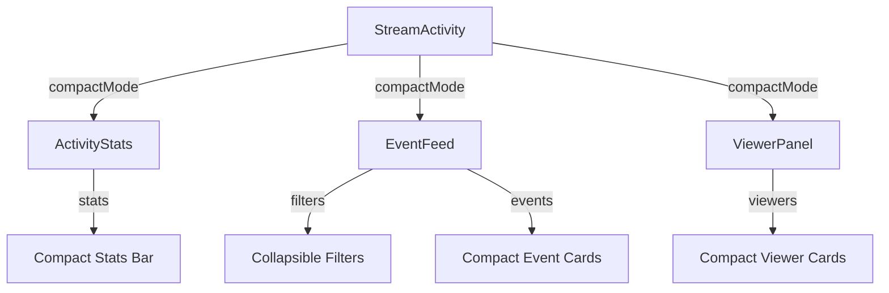

# Design Document: Activity UI Improvements

## Overview

Este documento describe el diseño técnico para las mejoras de UI en la sección de Actividad. El enfoque principal es reducir el ruido visual, mejorar la jerarquía de información y crear una experiencia más limpia y profesional.

Las mejoras se implementarán modificando los componentes existentes en `components/activity/` sin cambiar la arquitectura subyacente establecida en el refactor anterior.

## Architecture

### Componentes Afectados

```
components/
├── StreamActivity.tsx          # Orquestador - añadir toggle compact mode
└── activity/
    ├── ActivityStats.tsx       # Rediseño completo a barra compacta
    ├── EventFeed.tsx           # Mejoras en filtros y cards
    ├── ViewerPanel.tsx         # Cards compactas y badges como iconos
    └── index.ts                # Sin cambios
```

### Flujo de Datos



## Components and Interfaces

### 1. CompactMode Context

```typescript
// Nuevo contexto para modo compacto global
interface CompactModeContextValue {
  isCompact: boolean;
  toggleCompact: () => void;
}

// Hook para usar el modo compacto
const useCompactMode = (): CompactModeContextValue;
```

### 2. ActivityStats Rediseñado

```typescript
interface CompactStatItem {
  type: EventType;
  value: number;
  icon: React.ReactNode;
  color: string;
}

interface ActivityStatsProps {
  stats: ActivityStatsData;
  compact?: boolean;  // Nuevo: forzar modo compacto
}

// Diseño: Barra horizontal con 4 métricas principales
// Layout: flex row, gap-4, items-center
// Altura máxima: 40px en modo compacto
```

### 3. FilterChips Mejorado

```typescript
interface FilterChipsProps {
  filters: Set<ActivityEventType>;
  onFilterChange: (filters: Set<ActivityEventType>) => void;
  collapsed?: boolean;  // Nuevo: modo colapsado
  onToggleCollapse?: () => void;
}

// Diseño: Chips más pequeños (h-6), bordes sutiles
// Indicador activo: dot de 6px en lugar de fondo completo
// Toggle "Todos" que colapsa cuando todos activos
```

### 4. EventCard Compacto

```typescript
interface EventCardProps {
  event: ActivityStreamEvent;
  pollOptions?: Record<number, PollOption>;
  isNew?: boolean;
  compact?: boolean;  // Nuevo: modo compacto
}

// Diseño: Padding reducido, badges más pequeños
// Timestamp: formato relativo ("hace 2m")
// Layout: single line para username + badge
```

### 5. ViewerCard Compacto

```typescript
interface ViewerCardProps {
  viewer: ViewerData;
  compact?: boolean;  // Nuevo: modo compacto
  showTooltip?: boolean;  // Nuevo: info adicional en tooltip
}

// Diseño: Badges como iconos sin texto
// Hover: tooltip con info completa
// Padding reducido en modo compacto
```

## Data Models

### Color Palette Unificada

```typescript
// Paleta de colores centralizada para consistencia
export const UI_COLORS = {
  // Event types (ya existente, se mantiene)
  events: {
    follow: '#22c55e',
    sub: '#a855f7',
    resub: '#8b5cf6',
    gift: '#ec4899',
    raid: '#3b82f6',
    bits: '#f59e0b',
    vote: '#06b6d4',
    ban: '#ef4444',
    timeout: '#f97316',
  },
  
  // Background tints (10% opacity)
  tints: {
    follow: 'rgba(34, 197, 94, 0.1)',
    sub: 'rgba(168, 85, 247, 0.1)',
    // ... etc
  },
  
  // UI states
  states: {
    hover: 'rgba(255, 255, 255, 0.05)',
    active: 'rgba(255, 255, 255, 0.1)',
    disabled: 'rgba(255, 255, 255, 0.02)',
  },
} as const;
```

### Compact Mode Storage

```typescript
const COMPACT_MODE_KEY = 'activity_compact_mode';

// Persistencia en localStorage
const saveCompactMode = (isCompact: boolean): void => {
  localStorage.setItem(COMPACT_MODE_KEY, JSON.stringify(isCompact));
};

const loadCompactMode = (): boolean => {
  const stored = localStorage.getItem(COMPACT_MODE_KEY);
  return stored ? JSON.parse(stored) : false;
};
```

### Relative Time Formatter

```typescript
/**
 * Formatea un timestamp a tiempo relativo
 * @param timestamp - Unix timestamp en ms
 * @returns String como "hace 2m", "hace 1h", etc.
 */
const formatRelativeTime = (timestamp: number): string => {
  const now = Date.now();
  const diff = now - timestamp;
  
  const seconds = Math.floor(diff / 1000);
  const minutes = Math.floor(seconds / 60);
  const hours = Math.floor(minutes / 60);
  const days = Math.floor(hours / 24);
  
  if (days > 0) return `hace ${days}d`;
  if (hours > 0) return `hace ${hours}h`;
  if (minutes > 0) return `hace ${minutes}m`;
  return 'ahora';
};
```

## Correctness Properties

*A property is a characteristic or behavior that should hold true across all valid executions of a system—essentially, a formal statement about what the system should do. Properties serve as the bridge between human-readable specifications and machine-verifiable correctness guarantees.*

### Property 1: Relative Time Formatting

*For any* valid timestamp in the past, the `formatRelativeTime` function SHALL return a string that:
- Starts with "hace " or equals "ahora"
- Contains a numeric value followed by a time unit (s, m, h, d) for non-"ahora" results
- Returns "ahora" for timestamps within the last 60 seconds

**Validates: Requirements 3.3**

### Property 2: Event Color Consistency

*For any* event type, the color returned by `getEventColor(type)` SHALL always be the same value, regardless of:
- Which component calls the function
- The current UI state (compact mode, filters, etc.)
- The number of times the function is called

**Validates: Requirements 6.1, 6.2**

### Property 3: WCAG Contrast Compliance

*For any* combination of text color and background color used in the Activity section, the contrast ratio SHALL be at least 4.5:1 (WCAG AA standard for normal text).

**Validates: Requirements 6.4**

### Property 4: Compact Mode Persistence (Round-trip)

*For any* boolean value representing compact mode state, saving to localStorage and then loading SHALL return the same boolean value.

**Validates: Requirements 7.5**

## Error Handling

### Graceful Degradation

1. **localStorage no disponible**: Si localStorage no está disponible, el modo compacto defaultea a `false` y no persiste.

2. **Timestamps inválidos**: Si `formatRelativeTime` recibe un timestamp inválido o futuro, retorna "ahora".

3. **Colores no definidos**: Si se solicita un color para un tipo de evento no definido, se retorna un color gris por defecto (`#888888`).

### Accessibility Fallbacks

1. **prefers-reduced-motion**: Si el usuario tiene esta preferencia activa, todas las animaciones se desactivan.

2. **Contraste insuficiente**: El sistema usa colores pre-validados que cumplen WCAG AA.

## Testing Strategy

### Unit Tests

- Test de `formatRelativeTime` con diferentes rangos de tiempo
- Test de `getEventColor` para todos los tipos de evento
- Test de persistencia de compact mode en localStorage
- Test de cálculo de contraste WCAG

### Property-Based Tests

Se usará `fast-check` para los property tests:

1. **Relative Time Property**: Generar timestamps aleatorios y verificar formato de salida
2. **Color Consistency Property**: Llamar `getEventColor` múltiples veces y verificar consistencia
3. **Contrast Property**: Verificar ratios de contraste para todas las combinaciones de colores
4. **Persistence Property**: Round-trip test para compact mode

### Visual Regression Tests (Manual)

- Verificar que los componentes se ven correctamente en modo normal y compacto
- Verificar que las animaciones son suaves y no causan jank
- Verificar que los colores son consistentes en toda la UI

