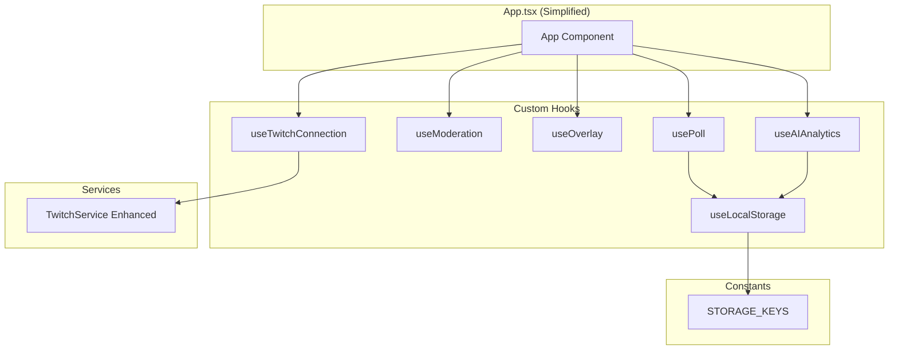

# Design Document: App Refactoring

## Overview

Esta refactorización tiene como objetivo reducir la complejidad de App.tsx (~1300 líneas) extrayendo lógica en hooks personalizados, centralizando constantes de localStorage, y mejorando el servicio de Twitch. El resultado será un código más mantenible, testeable y reutilizable.

## Architecture



## Components and Interfaces

### 1. useLocalStorage Hook

```typescript
interface UseLocalStorageOptions<T> {
  serializer?: (value: T) => string;
  deserializer?: (value: string) => T;
}

function useLocalStorage<T>(
  key: string,
  initialValue: T,
  options?: UseLocalStorageOptions<T>
): [T, (value: T | ((prev: T) => T)) => void];
```

### 2. usePoll Hook

```typescript
interface UsePollReturn {
  // State
  currentPoll: Poll | null;
  voteHistory: VoteRecord[];
  pastPolls: Poll[];
  votedUserIds: Set<string>;
  userVoteMap: Map<string, number>;
  
  // Actions
  createPoll: (config: CreatePollConfig) => void;
  stopPoll: (auto?: boolean) => void;
  resetPoll: () => void;
  addVote: (vote: VoteRecord, weight: number) => void;
  updateVote: (userId: string, oldOptionId: number, newOptionId: number, oldWeight: number, newWeight: number) => void;
}

interface CreatePollConfig {
  title: string;
  question: string;
  options: PollOptionConfig[];
  maxVotes?: number;
  duration?: number;
  progressBarColor?: string;
  limitIndicatorColor?: string;
}
```

### 3. useModeration Hook

```typescript
interface UseModerationReturn {
  // State
  config: ModerationConfig;
  stats: ModerationStats;
  log: ModerationLogEntry[];
  userVoteStates: Map<string, UserVoteState>;
  userWeights: Map<string, number>;
  
  // Actions
  setConfig: (config: ModerationConfig) => void;
  processVote: (voteContext: VoteContext) => VoteValidationResult;
  reset: () => void;
  logEntry: (entry: ModerationLogEntry) => void;
}

interface VoteContext {
  userId: string;
  username: string;
  optionId: number;
  tags: TwitchTags;
}

interface VoteValidationResult {
  isValid: boolean;
  weight: number;
  rejectionReason?: string;
  isVoteChange: boolean;
  previousOptionId?: number;
  previousWeight?: number;
}
```

### 4. useOverlay Hook

```typescript
interface UseOverlayReturn {
  // State
  isOverlayMode: boolean;
  settings: OverlaySettings;
  showSettings: boolean;
  
  // Actions
  setSettings: (settings: Partial<OverlaySettings>) => void;
  toggleSettings: () => void;
}

interface OverlaySettings {
  bgColor: string;
  textColor: string;
  borderColor: string;
  showBorders: boolean;
  fontSize: 'small' | 'medium' | 'large';
  fontStyle: 'normal' | 'bold' | 'italic';
  theme: 'dark' | 'light';
}
```

### 5. useTwitchConnection Hook

```typescript
interface UseTwitchConnectionReturn {
  // State
  status: ConnectionStatus;
  error: string | null;
  channelName: string;
  channelAvatar: string | null;
  authToken: string;
  
  // Actions
  connect: (channel: string, token?: string) => void;
  disconnect: () => void;
}
```

### 6. useAIAnalytics Hook

```typescript
interface UseAIAnalyticsReturn {
  // State
  config: AIConfig | null;
  currentSession: StreamSession | null;
  showConfig: boolean;
  
  // Mascot State
  showMascot: boolean;
  userDifficulty: UserDifficulty | undefined;
  connectionAttempts: number;
  
  // Actions
  setConfig: (config: AIConfig) => void;
  toggleConfig: () => void;
  toggleMascot: () => void;
  setUserDifficulty: (difficulty: UserDifficulty | undefined) => void;
  addMessageToSession: (message: StoredMessage) => void;
  addPollResultToSession: (result: PollSummary) => void;
}
```

### 7. Enhanced TwitchService

```typescript
interface TwitchServiceConfig {
  maxReconnectAttempts: number;
  reconnectBaseDelay: number;
  reconnectMaxDelay: number;
}

interface TwitchConnectionOptions {
  channel: string;
  token?: string;
  onMessage?: MessageCallback;
  onStatusChange?: StatusCallback;
  onReconnectAttempt?: (attempt: number, maxAttempts: number) => void;
}

type MessageCallback = (tags: tmi.ChatUserstate, message: string, self: boolean) => void;
type StatusCallback = (status: ConnectionStatus, error?: string) => void;

class TwitchService {
  private config: TwitchServiceConfig;
  private reconnectAttempts: number;
  private reconnectTimeout: NodeJS.Timeout | null;
  
  connect(options: TwitchConnectionOptions): Promise<void>;
  disconnect(): void;
  sendMessage(message: string): Promise<void>;
  getConnectionState(): ConnectionStatus;
}
```

## Data Models

### STORAGE_KEYS Constants

```typescript
export const STORAGE_KEYS = {
  // Poll Sync
  POLL_SYNC: 'twitch_vote_sync_poll',
  VOTE_HISTORY_SYNC: 'twitch_vote_sync_history',
  
  // Assets
  MEDIA_ASSETS: 'twitch_vote_assets',
  
  // AI Config
  AI_CONFIG: 'twitch_ai_config',
  STREAM_SESSIONS: 'twitch_stream_sessions',
  
  // Theme
  THEME: 'twitch_vote_theme',
} as const;

export type StorageKey = typeof STORAGE_KEYS[keyof typeof STORAGE_KEYS];
```

### File Structure

```
src/
├── hooks/
│   ├── index.ts
│   ├── useLocalStorage.ts
│   ├── usePoll.ts
│   ├── useModeration.ts
│   ├── useOverlay.ts
│   ├── useTwitchConnection.ts
│   └── useAIAnalytics.ts
├── constants/
│   ├── index.ts
│   ├── colors.ts
│   └── storageKeys.ts
├── services/
│   └── twitchService.ts (enhanced)
└── App.tsx (simplified)
```

## Correctness Properties

*A property is a characteristic or behavior that should hold true across all valid executions of a system-essentially, a formal statement about what the system should do. Properties serve as the bridge between human-readable specifications and machine-verifiable correctness guarantees.*

### Property 1: useLocalStorage Round-Trip Consistency
*For any* key, initial value, and subsequent value set via the hook, reading from localStorage should return the same value that was set.
**Validates: Requirements 5.2, 5.5**

### Property 2: useLocalStorage Graceful Degradation
*For any* corrupted or invalid JSON in localStorage, the hook should return the initial value without throwing.
**Validates: Requirements 5.3**

### Property 3: usePoll State Initialization
*For any* valid poll configuration, creating a poll should result in a poll with isActive=true, totalVotes=0, and options with votes=0.
**Validates: Requirements 1.2**

### Property 4: usePoll Stop Preserves History
*For any* active poll, stopping it should result in isActive=false and the poll being present in pastPolls.
**Validates: Requirements 1.3**

### Property 5: usePoll Reset Clears State
*For any* poll state, resetting should result in currentPoll=null, empty voteHistory, and empty votedUserIds.
**Validates: Requirements 1.4**

### Property 6: useModeration Vote Processing Updates Stats
*For any* vote processed through moderation, the stats should reflect the outcome (accepted count increases for valid votes, rejected count increases for invalid votes).
**Validates: Requirements 2.2**

### Property 7: useModeration Rejection Logging
*For any* rejected vote, the moderation log should contain an entry with the correct rejection reason.
**Validates: Requirements 2.4**

### Property 8: useModeration Reset Restores Defaults
*For any* moderation state, resetting should restore stats to DEFAULT_MODERATION_STATS and clear the log.
**Validates: Requirements 2.3**

### Property 9: useOverlay URL Detection
*For any* URL containing overlay=true parameter, the hook should initialize with isOverlayMode=true.
**Validates: Requirements 3.2, 3.4**

### Property 10: useTwitchConnection Disconnect Cleanup
*For any* connected state, disconnecting should result in status=DISCONNECTED, empty channelName, and null avatar.
**Validates: Requirements 8.3**

### Property 11: useAIAnalytics Session Lifecycle
*For any* stream session, ending it should result in the session having an endTime set.
**Validates: Requirements 7.3**

## Error Handling

### useLocalStorage
- **Parse errors**: Return initial value, log warning to console
- **Quota exceeded**: Catch error, trigger optional onError callback, don't crash
- **Invalid key**: TypeScript prevents at compile time via StorageKey type

### TwitchService
- **Connection failure**: Trigger reconnection with exponential backoff
- **Max reconnects exceeded**: Call onStatusChange with ERROR status and detailed message
- **Send message failure**: Log error, don't throw (fire-and-forget pattern)

### Hooks General
- All hooks should never throw exceptions
- Invalid inputs should result in no-op or default values
- State updates should be atomic where possible

## Testing Strategy

### Dual Testing Approach

This refactoring will use both unit tests and property-based tests:

1. **Unit Tests**: Verify specific examples, edge cases, and integration points
2. **Property-Based Tests**: Verify universal properties hold across all valid inputs

### Property-Based Testing Library

We will use **fast-check** for property-based testing in TypeScript/React.

### Test Configuration
- Minimum 100 iterations per property test
- Each property test tagged with format: `**Feature: app-refactoring, Property {number}: {property_text}**`

### Test Files Structure

```
tests/
├── hooks/
│   ├── useLocalStorage.test.ts
│   ├── useLocalStorage.property.test.ts
│   ├── usePoll.test.ts
│   ├── usePoll.property.test.ts
│   ├── useModeration.test.ts
│   ├── useModeration.property.test.ts
│   ├── useOverlay.test.ts
│   ├── useOverlay.property.test.ts
│   ├── useTwitchConnection.test.ts
│   └── useAIAnalytics.test.ts
└── services/
    └── twitchService.test.ts
```

### Unit Test Coverage
- Hook initialization returns correct interface
- Edge cases (empty inputs, null values)
- Error conditions (localStorage failures, connection errors)

### Property Test Coverage
- Round-trip consistency for localStorage
- State transitions for poll lifecycle
- Moderation validation logic
- URL parameter parsing for overlay mode
