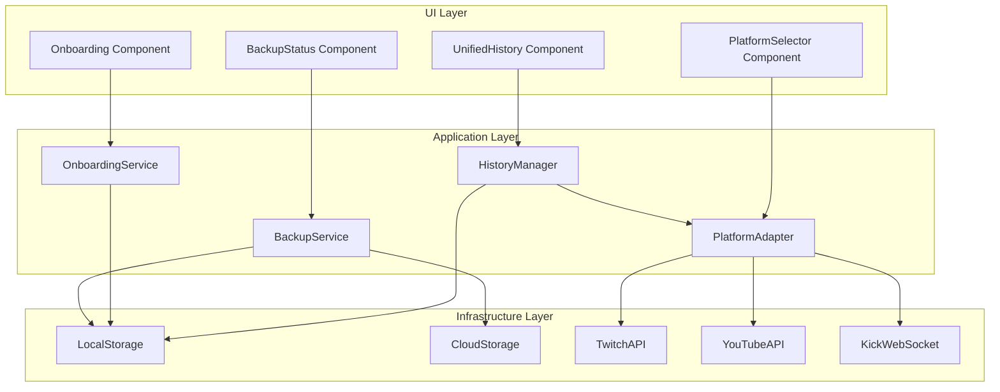

# Design Document: Enhanced Features

## Overview

Este documento describe el diseño técnico para implementar cuatro mejoras principales en TwitchVote:

1. **Historial Unificado**: Sistema centralizado para almacenar y consultar todas las actividades del usuario
2. **Onboarding Interactivo**: Tutorial mejorado con interacción real y progreso persistente
3. **Backup Automático**: Sincronización de configuración con almacenamiento en la nube
4. **Multi-Platform**: Soporte para YouTube y Kick además de Twitch

## Architecture



## Components and Interfaces

### 1. History Manager

```typescript
// types/history.ts
interface HistoryItem {
  id: string;
  type: 'poll' | 'prediction' | 'giveaway' | 'command' | 'timer';
  timestamp: number;
  platform: 'twitch' | 'youtube' | 'kick' | 'multi';
  data: PollHistoryData | PredictionHistoryData | GiveawayHistoryData | CommandHistoryData | TimerHistoryData;
  metadata: {
    participants?: number;
    totalVotes?: number;
    winner?: string;
    duration?: number;
  };
}

interface HistoryFilter {
  types?: HistoryItem['type'][];
  platforms?: HistoryItem['platform'][];
  dateFrom?: number;
  dateTo?: number;
  searchQuery?: string;
}

interface HistoryManager {
  addItem(item: Omit<HistoryItem, 'id' | 'timestamp'>): void;
  getItems(filter?: HistoryFilter): HistoryItem[];
  getItemById(id: string): HistoryItem | null;
  deleteItem(id: string): void;
  clearHistory(type?: HistoryItem['type']): void;
  exportToJSON(): string;
  importFromJSON(json: string): void;
}
```

### 2. Onboarding Service

```typescript
// types/onboarding.ts
interface OnboardingStep {
  id: string;
  target: string; // CSS selector
  title: string;
  message: string;
  action?: 'click' | 'input' | 'navigate';
  validation?: () => boolean;
  onComplete?: () => void;
}

interface OnboardingProgress {
  currentStep: number;
  completedSteps: string[];
  startedAt: number;
  lastActiveAt: number;
  isCompleted: boolean;
}

interface OnboardingService {
  isFirstVisit(): boolean;
  startTutorial(): void;
  getCurrentStep(): OnboardingStep | null;
  completeStep(stepId: string): void;
  skipTutorial(): void;
  resetTutorial(): void;
  getProgress(): OnboardingProgress;
  showContextualTip(context: string): void;
}
```

### 3. Backup Service

```typescript
// types/backup.ts
type CloudProvider = 'google-drive' | 'custom-server';

interface BackupConfig {
  provider: CloudProvider;
  credentials?: {
    accessToken?: string;
    refreshToken?: string;
    serverUrl?: string;
    apiKey?: string;
  };
  autoBackupEnabled: boolean;
  lastBackupAt?: number;
  lastSyncStatus: 'synced' | 'syncing' | 'error' | 'pending';
}

interface BackupData {
  version: number;
  timestamp: number;
  data: {
    commands: Command[];
    timers: Timer[];
    presets: Preset[];
    aiConfig: AIConfig;
    moderationSettings: ModerationConfig;
    customSounds: Sound[];
  };
  checksum: string;
}

interface BackupService {
  connect(provider: CloudProvider, credentials: object): Promise<void>;
  disconnect(): void;
  backup(): Promise<void>;
  restore(): Promise<BackupData>;
  getStatus(): BackupConfig['lastSyncStatus'];
  scheduleBackup(delayMs: number): void;
  cancelScheduledBackup(): void;
  encryptSensitiveData(data: object): string;
  decryptSensitiveData(encrypted: string): object;
}
```

### 4. Platform Adapter

```typescript
// types/platform.ts
type Platform = 'twitch' | 'youtube' | 'kick';

interface PlatformConnection {
  platform: Platform;
  status: 'connected' | 'connecting' | 'disconnected' | 'error';
  channel: string;
  enabled: boolean;
  lastError?: string;
}

interface ChatMessage {
  id: string;
  platform: Platform;
  username: string;
  displayName: string;
  message: string;
  timestamp: number;
  badges: Badge[];
  isVote?: boolean;
  voteValue?: string;
}

interface Badge {
  type: 'subscriber' | 'moderator' | 'vip' | 'member' | 'owner';
  platform: Platform;
  tier?: number;
}

interface PlatformAdapter {
  connect(platform: Platform, channel: string): Promise<void>;
  disconnect(platform: Platform): void;
  disconnectAll(): void;
  getConnections(): PlatformConnection[];
  sendMessage(platform: Platform, message: string): Promise<void>;
  onMessage(callback: (message: ChatMessage) => void): void;
  enablePlatform(platform: Platform): void;
  disablePlatform(platform: Platform): void;
}
```

## Data Models

### History Storage Schema

```typescript
interface HistoryStorage {
  version: 1;
  items: {
    polls: HistoryItem[];      // max 100
    predictions: HistoryItem[]; // max 100
    giveaways: HistoryItem[];   // max 100
    commands: HistoryItem[];    // max 100
    timers: HistoryItem[];      // max 100
  };
  lastUpdated: number;
}
```

### Onboarding Storage Schema

```typescript
interface OnboardingStorage {
  version: 1;
  hasSeenWelcome: boolean;
  progress: OnboardingProgress;
  dismissedTips: string[];
  preferences: {
    showContextualTips: boolean;
  };
}
```

### Platform Connections Storage

```typescript
interface PlatformStorage {
  version: 1;
  connections: {
    twitch?: { channel: string; token?: string };
    youtube?: { channelId: string; token?: string };
    kick?: { channel: string; token?: string };
  };
  preferences: {
    defaultPlatform: Platform;
    multiPlatformEnabled: boolean;
  };
}
```

## Correctness Properties

*A property is a characteristic or behavior that should hold true across all valid executions of a system—essentially, a formal statement about what the system should do. Properties serve as the bridge between human-readable specifications and machine-verifiable correctness guarantees.*

### Property 1: History Recording Completeness

*For any* activity (poll, prediction, giveaway, command, timer) that is created or completed, the History_Manager SHALL record it with a valid timestamp and all required metadata fields populated.

**Validates: Requirements 1.2**

### Property 2: History Filtering Correctness

*For any* history collection and filter criteria (type and/or date range), the filtered results SHALL contain only items that match ALL specified criteria, and SHALL contain ALL items that match those criteria.

**Validates: Requirements 1.3, 1.4**

### Property 3: History Limit Enforcement

*For any* history category, when the number of items exceeds 100, the History_Manager SHALL retain exactly 100 items, and those items SHALL be the 100 most recent by timestamp.

**Validates: Requirements 1.6, 1.7**

### Property 4: History Export Round-Trip

*For any* valid history collection, exporting to JSON and then importing that JSON SHALL produce an equivalent history collection with all items preserved.

**Validates: Requirements 1.8**

### Property 5: Onboarding Step Progression

*For any* onboarding state, completing a step SHALL advance to the next step, skipping SHALL end the tutorial, and resuming SHALL restore the last active step.

**Validates: Requirements 2.4, 2.5, 2.7**

### Property 6: Backup Scheduling on Changes

*For any* configuration change when auto-backup is enabled, the Backup_Service SHALL schedule a backup within 5 minutes, and multiple changes within that window SHALL result in a single backup.

**Validates: Requirements 3.3**

### Property 7: Backup Data Completeness

*For any* backup operation, the resulting backup data SHALL include all specified data types (commands, timers, presets, AI config, moderation settings, custom sounds) that exist in the application.

**Validates: Requirements 3.4**

### Property 8: Backup Retry Behavior

*For any* failed backup attempt, the Backup_Service SHALL retry up to 3 times with exponentially increasing delays, and SHALL report error status only after all retries are exhausted.

**Validates: Requirements 3.6**

### Property 9: Sensitive Data Encryption

*For any* backup containing sensitive data (API keys, tokens), the encrypted output SHALL NOT contain the plaintext values, and decrypting SHALL restore the original values.

**Validates: Requirements 3.9**

### Property 10: Vote Processing Across Platforms

*For any* chat message from any platform (Twitch, YouTube, Kick) that matches the vote format (+1, +2, +key), the Platform_Adapter SHALL process it identically regardless of source platform.

**Validates: Requirements 4.5, 5.5**

### Property 11: Platform Badge Display

*For any* user with platform-specific badges, the display SHALL show the correct badge type and tier for that platform.

**Validates: Requirements 4.6, 5.6**

### Property 12: Rate Limit Queue Handling

*For any* sequence of messages when rate limit is reached, the Platform_Adapter SHALL queue messages and deliver them in order when the rate limit resets.

**Validates: Requirements 4.7**

### Property 13: Reconnection Behavior

*For any* connection loss, the Platform_Adapter SHALL attempt reconnection with exponential backoff, and SHALL restore the previous state upon successful reconnection.

**Validates: Requirements 5.7**

### Property 14: Multi-Platform Vote Aggregation

*For any* poll with votes from multiple platforms, the aggregated vote count SHALL equal the sum of votes from each individual platform.

**Validates: Requirements 6.2**

### Property 15: Multi-Platform State Independence

*For any* set of connected platforms, the connection state of one platform SHALL NOT affect the operation of other platforms, and enabling/disabling SHALL only affect vote processing without disconnecting.

**Validates: Requirements 6.4, 6.5, 6.6**

## Error Handling

### History Manager Errors

| Error | Handling |
|-------|----------|
| localStorage full | Remove oldest items beyond limit, show warning |
| Corrupted data | Attempt recovery, fallback to empty state |
| Import invalid JSON | Reject import, show error message |

### Backup Service Errors

| Error | Handling |
|-------|----------|
| Network failure | Retry with exponential backoff (1s, 2s, 4s) |
| Auth expired | Prompt re-authentication |
| Quota exceeded | Show warning, disable auto-backup |
| Encryption failure | Abort backup, show error |

### Platform Adapter Errors

| Error | Handling |
|-------|----------|
| Connection refused | Retry with backoff, show status |
| Rate limited | Queue messages, wait for reset |
| Invalid credentials | Prompt re-authentication |
| WebSocket closed | Auto-reconnect with backoff |

## Testing Strategy

### Unit Tests

- History filtering logic
- Date range calculations
- Onboarding state transitions
- Encryption/decryption functions
- Vote parsing across platforms
- Badge mapping functions

### Property-Based Tests

Using fast-check for TypeScript:

1. **History tests**: Generate random history items, verify filtering and limits
2. **Backup tests**: Generate random configs, verify round-trip and encryption
3. **Vote tests**: Generate random chat messages, verify parsing consistency
4. **State tests**: Generate random platform states, verify independence

### Integration Tests

- localStorage persistence
- Cloud backup flow (mocked)
- Multi-platform message aggregation
- Onboarding flow completion

### Configuration

- Minimum 100 iterations per property test
- Tag format: **Feature: enhanced-features, Property {number}: {property_text}**
