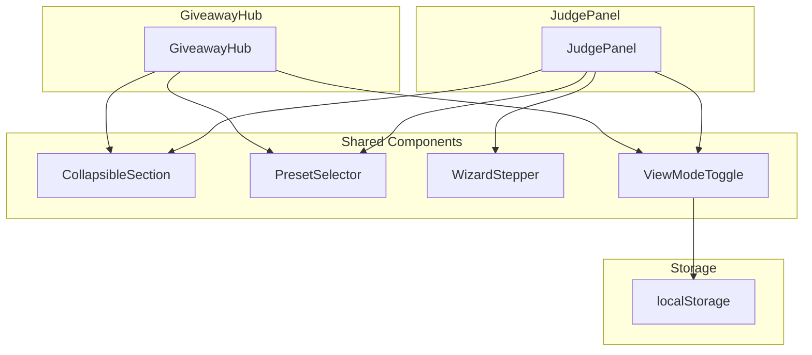

# Design Document: Forms UI Improvement

## Overview

Este diseño describe la arquitectura y componentes necesarios para mejorar la experiencia de usuario en los formularios de GiveawayHub y JudgePanel. La solución se basa en cuatro pilares: componentes reutilizables, secciones colapsables, wizard de configuración y presets.

## Architecture



## Components and Interfaces

### CollapsibleSection Component

```typescript
interface CollapsibleSectionProps {
  title: string;
  icon?: React.ReactNode;
  badge?: string | number;
  defaultExpanded?: boolean;
  children: React.ReactNode;
  className?: string;
}

// Usage example
<CollapsibleSection 
  title="Opciones Avanzadas" 
  icon={<Settings size={16} />}
  badge={3}
  defaultExpanded={false}
>
  {/* Content */}
</CollapsibleSection>
```

### PresetSelector Component

```typescript
interface Preset<T> {
  id: string;
  name: string;
  description?: string;
  icon?: React.ReactNode;
  values: Partial<T>;
}

interface PresetSelectorProps<T> {
  presets: Preset<T>[];
  currentValues: T;
  onSelect: (preset: Preset<T>) => void;
  isCustomized: boolean;
}
```

### WizardStepper Component

```typescript
interface WizardStep {
  id: string;
  title: string;
  icon?: React.ReactNode;
  isComplete?: boolean;
  isOptional?: boolean;
}

interface WizardStepperProps {
  steps: WizardStep[];
  currentStep: number;
  onStepChange: (step: number) => void;
}
```

### ViewModeToggle Component

```typescript
type ViewMode = 'compact' | 'expanded';

interface ViewModeToggleProps {
  mode: ViewMode;
  onChange: (mode: ViewMode) => void;
  storageKey?: string;
}
```

## Data Models

### GiveawayHub Presets

```typescript
const GIVEAWAY_PRESETS: Preset<GiveawayConfig>[] = [
  {
    id: 'quick',
    name: 'Sorteo Rápido',
    description: 'Viewers del chat, sin timer',
    icon: <Zap />,
    values: {
      mode: 'viewers',
      useTimer: false,
      subsOnly: false,
    }
  },
  {
    id: 'keyword',
    name: 'Sorteo por Keyword',
    description: 'Palabra clave, 60 segundos',
    icon: <MessageSquare />,
    values: {
      mode: 'keyword',
      useTimer: true,
      timeLimit: 60,
      subsOnly: false,
    }
  },
  {
    id: 'subs',
    name: 'Sorteo de Subs',
    description: 'Solo suscriptores',
    icon: <Heart />,
    values: {
      mode: 'subs',
      useTimer: false,
    }
  }
];
```

### JudgePanel Presets

```typescript
const JUDGE_PRESETS: Preset<JudgePanelConfig>[] = [
  {
    id: 'basic',
    name: 'Torneo Básico',
    description: '3 criterios estándar',
    icon: <Trophy />,
    values: {
      criteria: [
        { name: 'Creatividad', minScore: 1, maxScore: 10, weight: 1 },
        { name: 'Ejecución', minScore: 1, maxScore: 10, weight: 1 },
        { name: 'Originalidad', minScore: 1, maxScore: 10, weight: 1 },
      ],
      publicVotingEnabled: false,
    }
  },
  {
    id: 'public',
    name: 'Torneo con Público',
    description: '3 criterios + votación pública 30%',
    icon: <Users />,
    values: {
      criteria: [
        { name: 'Creatividad', minScore: 1, maxScore: 10, weight: 1 },
        { name: 'Ejecución', minScore: 1, maxScore: 10, weight: 1 },
        { name: 'Originalidad', minScore: 1, maxScore: 10, weight: 1 },
      ],
      publicVotingEnabled: true,
      publicVoteWeight: 0.3,
    }
  }
];
```

### Section Configuration

```typescript
// GiveawayHub sections
const GIVEAWAY_SECTIONS = [
  { id: 'basic', title: 'Configuración Básica', icon: <Settings />, defaultExpanded: true },
  { id: 'advanced', title: 'Opciones Avanzadas', icon: <Sliders />, defaultExpanded: false },
  { id: 'participants', title: 'Participantes', icon: <Users />, defaultExpanded: false },
  { id: 'blacklist', title: 'Lista Negra', icon: <Ban />, defaultExpanded: false },
];

// JudgePanel sections
const JUDGE_SECTIONS = [
  { id: 'general', title: 'Configuración General', icon: <Settings />, defaultExpanded: true },
  { id: 'criteria', title: 'Criterios de Evaluación', icon: <Target />, defaultExpanded: false },
  { id: 'contestants', title: 'Concursantes', icon: <Users />, defaultExpanded: false },
  { id: 'judges', title: 'Jueces', icon: <Gavel />, defaultExpanded: false },
  { id: 'voting', title: 'Votación Pública', icon: <Vote />, defaultExpanded: false },
];
```

## Correctness Properties

*A property is a characteristic or behavior that should hold true across all valid executions of a system-essentially, a formal statement about what the system should do. Properties serve as the bridge between human-readable specifications and machine-verifiable correctness guarantees.*

### Property 1: CollapsibleSection Toggle Consistency
*For any* CollapsibleSection component, clicking the header should toggle the expanded state from true to false or from false to true, and the children visibility should match the expanded state.
**Validates: Requirements 1.2, 1.4**

### Property 2: CollapsibleSection Badge Display
*For any* CollapsibleSection with a badge prop, the badge value should be displayed next to the title when the prop is provided, and hidden when the prop is undefined or null.
**Validates: Requirements 1.6**

### Property 3: Participant Count Badge Accuracy
*For any* GiveawayHub state with N participants, the Participantes section badge should display the value N.
**Validates: Requirements 2.4**

### Property 4: Blacklist Count Badge Accuracy
*For any* GiveawayHub state with N blacklisted users, the Lista Negra section badge should display the value N.
**Validates: Requirements 2.5**

### Property 5: JudgePanel Badge Counts
*For any* JudgePanel state with N criteria, M contestants, and P judges, the respective section badges should display N, M, and P.
**Validates: Requirements 3.3, 3.4, 3.5**

### Property 6: Preset Application Completeness
*For any* preset selection, all values defined in the preset should be applied to the corresponding configuration fields.
**Validates: Requirements 5.3, 6.3**

### Property 7: Preset Customization Detection
*For any* configuration that has been modified after applying a preset, the preset selector should show "Personalizado" as the current selection.
**Validates: Requirements 5.6, 6.6**

### Property 8: View Mode Persistence
*For any* view mode change, the new mode should be persisted to localStorage and restored on component mount.
**Validates: Requirements 7.4**

### Property 9: View Mode Value Preservation
*For any* view mode switch, all current configuration values should remain unchanged after the switch.
**Validates: Requirements 7.5**

### Property 10: Wizard Step Navigation
*For any* wizard step N (where 1 <= N <= total steps), the "Back" button should navigate to step N-1 (if N > 1) and the "Next" button should navigate to step N+1 (if N < total steps).
**Validates: Requirements 4.3**

## Error Handling

1. **Invalid Preset**: If a preset contains invalid values, log a warning and apply only valid values
2. **localStorage Unavailable**: If localStorage is not available, fall back to in-memory state for view mode
3. **Missing Children**: CollapsibleSection should render empty content gracefully if children is undefined

## Testing Strategy

### Unit Tests
- CollapsibleSection renders with all prop combinations
- PresetSelector displays all presets correctly
- WizardStepper shows correct step indicators
- ViewModeToggle persists to localStorage

### Property-Based Tests
- Property 1: Toggle consistency across random click sequences
- Property 3-5: Badge accuracy with random participant/criteria/contestant/judge counts
- Property 6: Preset application with various preset configurations
- Property 7: Customization detection with random field modifications
- Property 8-9: View mode persistence and value preservation

### Integration Tests
- GiveawayHub sections expand/collapse correctly
- JudgePanel wizard flow completes successfully
- Presets apply correctly in both components
- View mode toggle works across page refreshes
