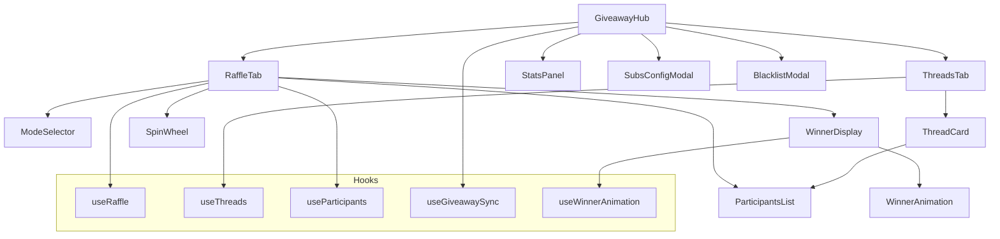

# Design Document: Giveaway System Improvements

## Overview

Este documento describe el diseño técnico para las mejoras del sistema de sorteos (GiveawayHub). El objetivo principal es refactorizar el componente monolítico de 3500+ líneas en una arquitectura modular, mejorar la experiencia de usuario con animaciones más atractivas, y añadir nuevas funcionalidades como presets de configuración y estadísticas.

## Architecture

### Estructura de Directorios Propuesta

```
components/
└── giveaway/
    ├── index.ts                    # Re-exports
    ├── GiveawayHub.tsx             # Componente contenedor principal (~200 líneas)
    ├── RaffleTab.tsx               # Tab de sorteo rápido
    ├── ThreadsTab.tsx              # Tab de hilos activos
    ├── ModeSelector.tsx            # Selector de modo con cards visuales
    ├── ParticipantsList.tsx        # Lista de participantes
    ├── WinnerDisplay.tsx           # Visualización del ganador con animación
    ├── WinnerAnimation.tsx         # Lógica de animación de selección
    ├── ThreadCard.tsx              # Card individual de hilo
    ├── SpinWheel.tsx               # Rueda de la fortuna (prioridad baja)
    ├── StatsPanel.tsx              # Panel de estadísticas (prioridad baja)
    ├── modals/
    │   ├── SubsConfigModal.tsx     # Modal de configuración de subs
    │   └── BlacklistModal.tsx      # Modal de lista de prohibidos
    ├── hooks/
    │   ├── useRaffle.ts            # Estado y acciones de sorteo
    │   ├── useThreads.ts           # Gestión de hilos
    │   ├── useParticipants.ts      # Gestión de participantes
    │   ├── useGiveawaySync.ts      # Sincronización Firebase/BroadcastChannel
    │   └── useWinnerAnimation.ts   # Lógica de animación
    ├── services/
    │   └── GiveawayStorage.ts      # Persistencia y migración de datos
    └── types/
        └── index.ts                # Tipos específicos de giveaway
```

### Diagrama de Componentes



## Components and Interfaces

### 1. GiveawayHub (Contenedor Principal)

```typescript
interface GiveawayHubProps {
  chatMessages: TwitchMessage[];
  isConnected: boolean;
  onClearChatMessages?: () => void;
  authToken?: string;
  userId?: string;
}

// El componente principal solo orquesta los sub-componentes
const GiveawayHub: React.FC<GiveawayHubProps> = (props) => {
  const [activeTab, setActiveTab] = useState<'raffle' | 'active' | 'stats'>('raffle');
  const sync = useGiveawaySync();
  
  return (
    <div className="giveaway-hub">
      <Header activeTab={activeTab} onTabChange={setActiveTab} />
      {activeTab === 'raffle' && <RaffleTab {...props} sync={sync} />}
      {activeTab === 'active' && <ThreadsTab {...props} sync={sync} />}
      {activeTab === 'stats' && <StatsPanel />}
    </div>
  );
};
```

### 2. ModeSelector

```typescript
interface ModeSelectorProps {
  mode: RaffleMode;
  onModeChange: (mode: RaffleMode) => void;
  disabled?: boolean;
}

interface ModeCardConfig {
  id: RaffleMode;
  icon: React.ReactNode;
  title: string;
  description: string;
  gradient: string;
  activeGradient: string;
}

const MODE_CONFIGS: ModeCardConfig[] = [
  {
    id: 'viewers',
    icon: <Users />,
    title: 'Viewers',
    description: 'Todos los que escriban en el chat',
    gradient: 'from-purple-500/20 to-indigo-500/20',
    activeGradient: 'from-purple-500 to-indigo-500',
  },
  {
    id: 'keyword',
    icon: <Hash />,
    title: 'Palabra Clave',
    description: 'Escriben una palabra para participar',
    gradient: 'from-cyan-500/20 to-blue-500/20',
    activeGradient: 'from-cyan-500 to-blue-500',
  },
  {
    id: 'subs',
    icon: <Heart />,
    title: 'Suscriptores',
    description: 'Entradas ponderadas por tier',
    gradient: 'from-pink-500/20 to-rose-500/20',
    activeGradient: 'from-pink-500 to-rose-500',
  },
];
```

### 3. WinnerAnimation

```typescript
interface WinnerAnimationConfig {
  totalDuration: number;      // 3000-4000ms
  startInterval: number;      // 50ms
  endInterval: number;        // 500ms
  nearMissThreshold: number;  // 0.8 (80%)
  easingFunction: (t: number) => number;
}

interface UseWinnerAnimationReturn {
  isAnimating: boolean;
  currentDisplay: string;
  nearMissCandidates: string[];
  progress: number;
  startAnimation: (candidates: string[]) => Promise<string>;
  skipAnimation: () => void;
  reset: () => void;
}

// Easing function para desaceleración natural
const easeOutQuart = (t: number): number => 1 - Math.pow(1 - t, 4);

const useWinnerAnimation = (config: Partial<WinnerAnimationConfig> = {}): UseWinnerAnimationReturn => {
  const finalConfig: WinnerAnimationConfig = {
    totalDuration: 3500,
    startInterval: 50,
    endInterval: 500,
    nearMissThreshold: 0.8,
    easingFunction: easeOutQuart,
    ...config,
  };
  
  // Implementation...
};
```

### 4. Custom Hooks

#### useRaffle

```typescript
interface RaffleState {
  mode: RaffleMode;
  isRunning: boolean;
  winner: string | null;
  timeLeft: number;
  config: RaffleConfig;
}

interface RaffleActions {
  setMode: (mode: RaffleMode) => void;
  start: () => void;
  stop: () => void;
  selectWinner: (candidates: string[]) => Promise<string>;
  reset: () => void;
  updateConfig: (config: Partial<RaffleConfig>) => void;
}

type UseRaffleReturn = [RaffleState, RaffleActions];

const useRaffle = (initialConfig?: Partial<RaffleConfig>): UseRaffleReturn => {
  // Reducer-based state management
  const [state, dispatch] = useReducer(raffleReducer, getInitialState(initialConfig));
  
  // Actions memoized
  const actions = useMemo(() => ({
    setMode: (mode: RaffleMode) => dispatch({ type: 'SET_MODE', payload: mode }),
    start: () => dispatch({ type: 'START' }),
    // ...
  }), []);
  
  return [state, actions];
};
```

#### useThreads

```typescript
interface UseThreadsReturn {
  threads: GiveawayThread[];
  activeCount: number;
  createThread: (config: CreateThreadConfig) => GiveawayThread;
  deleteThread: (id: string) => void;
  toggleThread: (id: string) => void;
  pickWinner: (id: string) => Promise<string>;
  addParticipant: (threadId: string, participant: GiveawayParticipant) => void;
}
```

#### useParticipants

```typescript
interface UseParticipantsReturn {
  participants: Set<string>;
  count: number;
  add: (name: string) => boolean;
  remove: (name: string) => void;
  clear: () => void;
  isBlacklisted: (name: string) => boolean;
  filterBlacklisted: (names: string[]) => string[];
  exportList: () => string;
  importList: (content: string) => number;
}
```

### 5. GiveawayStorage Service

```typescript
interface GiveawayData {
  version: number;
  threads: GiveawayThread[];
  history: FinishedGiveaway[];
  stats: GiveawayStats;
  subsConfig: SubsGiveawayConfig;
  blacklist: string[];
}

class GiveawayStorage {
  private static readonly CURRENT_VERSION = 2;
  private static readonly KEYS = {
    threads: 'giveaway_threads',
    history: 'giveaway_history',
    stats: 'giveaway_stats',
    config: 'giveaway_subs_config',
    blacklist: 'giveaway_blacklist',
    backup: 'giveaway_backup',
  };

  // Migración automática de versiones
  static migrate(data: unknown): GiveawayData {
    if (!data || typeof data !== 'object') {
      return this.getDefaultData();
    }
    
    const version = (data as { version?: number }).version || 1;
    
    if (version === 1) {
      // Migrar de v1 a v2
      return this.migrateV1toV2(data as GiveawayDataV1);
    }
    
    return data as GiveawayData;
  }

  // Validación de datos
  static validate(data: GiveawayData): ValidationResult {
    const errors: string[] = [];
    
    if (!Array.isArray(data.threads)) {
      errors.push('threads must be an array');
    }
    
    data.threads.forEach((thread, i) => {
      if (!thread.id) errors.push(`thread[${i}] missing id`);
      if (!thread.name) errors.push(`thread[${i}] missing name`);
      // ...
    });
    
    return { isValid: errors.length === 0, errors };
  }

  // Compresión para datos grandes
  static compress(data: string): string {
    // Usar LZ-string o similar para compresión
    return LZString.compressToUTF16(data);
  }

  static decompress(data: string): string {
    return LZString.decompressFromUTF16(data) || data;
  }

  // API pública
  static saveThreads(threads: GiveawayThread[]): void;
  static getThreads(): GiveawayThread[];
  static saveHistory(history: FinishedGiveaway[]): void;
  static getHistory(): FinishedGiveaway[];
  static exportAll(): string;
  static importAll(json: string): ImportResult;
}
```

### 6. Subs Config Presets

```typescript
interface SubsPreset {
  id: string;
  name: string;
  description: string;
  icon: React.ReactNode;
  config: SubsGiveawayConfig;
}

const SUBS_PRESETS: SubsPreset[] = [
  {
    id: 'simple',
    name: 'Simple',
    description: 'Todos los tiers valen igual',
    icon: <Equal />,
    config: {
      tier1Value: 1,
      tier2Value: 1,
      tier3Value: 1,
      primeValue: 1,
      resubEnabled: true,
      resubValue: 1,
      resubBonusPerMonth: 0,
      giftSubEnabled: true,
      giftSubValue: 1,
      bitsEnabled: false,
      bitsPerEntry: 100,
      bitsMinimum: 100,
      donationsEnabled: false,
      donationPerEntry: 1,
      donationMinimum: 1,
      donationCurrency: 'EUR',
      channelGiftsEnabled: false,
      channelGiftValue: 1,
    },
  },
  {
    id: 'weighted',
    name: 'Ponderado',
    description: 'Tier 3 vale más que Tier 1',
    icon: <Scale />,
    config: {
      tier1Value: 1,
      tier2Value: 2,
      tier3Value: 5,
      primeValue: 1,
      resubEnabled: true,
      resubValue: 1,
      resubBonusPerMonth: 0.5,
      giftSubEnabled: true,
      giftSubValue: 1,
      bitsEnabled: false,
      // ...
    },
  },
  {
    id: 'vip',
    name: 'VIP',
    description: 'Incluye bits y donaciones',
    icon: <Crown />,
    config: {
      tier1Value: 1,
      tier2Value: 3,
      tier3Value: 10,
      primeValue: 1,
      resubEnabled: true,
      resubValue: 2,
      resubBonusPerMonth: 1,
      giftSubEnabled: true,
      giftSubValue: 2,
      bitsEnabled: true,
      bitsPerEntry: 100,
      bitsMinimum: 50,
      donationsEnabled: true,
      donationPerEntry: 1,
      donationMinimum: 1,
      donationCurrency: 'EUR',
      channelGiftsEnabled: true,
      channelGiftValue: 2,
    },
  },
];
```

## Data Models

### GiveawayStats (Nueva)

```typescript
interface GiveawayStats {
  totalGiveaways: number;
  totalParticipants: number;
  uniqueWinners: string[];
  participantCounts: number[];  // Para calcular promedio
  byMode: {
    viewers: number;
    keyword: number;
    subs: number;
  };
  lastUpdated: number;
}

const DEFAULT_STATS: GiveawayStats = {
  totalGiveaways: 0,
  totalParticipants: 0,
  uniqueWinners: [],
  participantCounts: [],
  byMode: { viewers: 0, keyword: 0, subs: 0 },
  lastUpdated: Date.now(),
};
```

### Animation State

```typescript
interface AnimationState {
  phase: 'idle' | 'spinning' | 'slowing' | 'nearMiss' | 'winner' | 'celebration';
  progress: number;
  currentDisplay: string;
  nearMissCandidates: string[];
  winner: string | null;
}
```

## Correctness Properties

*A property is a characteristic or behavior that should hold true across all valid executions of a system—essentially, a formal statement about what the system should do. Properties serve as the bridge between human-readable specifications and machine-verifiable correctness guarantees.*

### Property 1: Component Line Count Constraint
*For any* component file in `components/giveaway/`, the line count SHALL be less than or equal to 300 lines.
**Validates: Requirements 1.1**

### Property 2: Hook Interface Consistency
*For any* custom hook (useRaffle, useThreads, useParticipants), the return value SHALL match its defined TypeScript interface, providing both state and action functions.
**Validates: Requirements 2.1, 2.2, 2.3, 2.5**

### Property 3: Animation Timing Progression
*For any* winner selection animation, the interval between display updates SHALL monotonically increase from startInterval (50ms) to endInterval (500ms) following the easing function.
**Validates: Requirements 3.1, 3.2, 3.3**

### Property 4: Near-Miss Threshold Trigger
*For any* animation progress value greater than 0.8 (80%), the animation state SHALL include nearMissCandidates with at least 2 alternative names.
**Validates: Requirements 3.4**

### Property 5: Preset Configuration Completeness
*For any* subs preset, applying it SHALL set ALL fields of SubsGiveawayConfig to valid values (no undefined or null).
**Validates: Requirements 4.2, 4.3**

### Property 6: Storage Data Round-Trip
*For any* valid GiveawayData object, exporting and then importing SHALL produce an equivalent object (export(import(data)) ≈ data).
**Validates: Requirements 5.6**

### Property 7: Storage Migration Idempotence
*For any* data that has been migrated to the current version, calling migrate again SHALL return an equivalent object.
**Validates: Requirements 5.2**

### Property 8: Storage Validation Correctness
*For any* GiveawayData object, if validate() returns isValid=true, then all required fields SHALL be present and have correct types.
**Validates: Requirements 5.3**

### Property 9: Mode Selection Visual State
*For any* selected mode in ModeSelector, exactly one card SHALL have the active gradient class, and it SHALL be the card matching the selected mode.
**Validates: Requirements 6.2, 6.4**

### Property 10: Spin Wheel Availability
*For any* participant count N, the SpinWheel option SHALL be available if and only if N ≤ 20 and N > 0.
**Validates: Requirements 7.1**

### Property 11: Statistics Accumulation
*For any* completed giveaway, the stats.totalGiveaways SHALL increment by 1, and stats.totalParticipants SHALL increment by the participant count.
**Validates: Requirements 8.1**

### Property 12: Statistics Export Format
*For any* statistics export, the output SHALL be valid JSON or CSV that can be parsed without errors.
**Validates: Requirements 8.4**

### Property 13: Mobile Participant Count Sync
*For any* change to participant count on desktop, the mobile interface SHALL reflect the same count within 1 second.
**Validates: Requirements 9.3**

## Error Handling

### Storage Errors

```typescript
class GiveawayStorageError extends Error {
  constructor(
    message: string,
    public readonly code: 'QUOTA_EXCEEDED' | 'PARSE_ERROR' | 'VALIDATION_ERROR' | 'MIGRATION_ERROR',
    public readonly originalError?: Error
  ) {
    super(message);
    this.name = 'GiveawayStorageError';
  }
}

// Manejo en GiveawayStorage
static saveThreads(threads: GiveawayThread[]): void {
  try {
    const validation = this.validate({ threads, ...this.getDefaultData() });
    if (!validation.isValid) {
      console.error('Validation errors:', validation.errors);
      throw new GiveawayStorageError(
        'Invalid thread data',
        'VALIDATION_ERROR'
      );
    }
    
    const json = JSON.stringify(threads);
    const compressed = json.length > 10000 ? this.compress(json) : json;
    
    localStorage.setItem(this.KEYS.threads, compressed);
  } catch (error) {
    if (error instanceof DOMException && error.name === 'QuotaExceededError') {
      throw new GiveawayStorageError(
        'Storage quota exceeded. Please export and clear old data.',
        'QUOTA_EXCEEDED',
        error
      );
    }
    throw error;
  }
}
```

### Animation Errors

```typescript
// Si la animación falla, seleccionar ganador inmediatamente
const startAnimation = async (candidates: string[]): Promise<string> => {
  if (candidates.length === 0) {
    throw new Error('No candidates provided');
  }
  
  try {
    return await runAnimation(candidates);
  } catch (error) {
    console.error('Animation failed, selecting winner directly:', error);
    const winner = candidates[Math.floor(Math.random() * candidates.length)];
    setState({ phase: 'winner', winner });
    return winner;
  }
};
```

## Testing Strategy

### Unit Tests

Los unit tests se enfocarán en:
- Funciones de utilidad (easing, formateo de tiempo)
- Validación de datos en GiveawayStorage
- Lógica de migración de datos
- Cálculo de estadísticas

### Property-Based Tests

Se usará **fast-check** para property-based testing en TypeScript:

```typescript
import fc from 'fast-check';

// Property 6: Storage Round-Trip
describe('GiveawayStorage', () => {
  it('should round-trip data correctly', () => {
    fc.assert(
      fc.property(
        fc.record({
          threads: fc.array(arbitraryGiveawayThread()),
          history: fc.array(arbitraryFinishedGiveaway()),
          // ...
        }),
        (data) => {
          const exported = GiveawayStorage.exportAll(data);
          const imported = GiveawayStorage.importAll(exported);
          return deepEqual(data, imported.data);
        }
      ),
      { numRuns: 100 }
    );
  });
});
```

### Integration Tests

- Verificar que los componentes refactorizados renderizan correctamente
- Verificar sincronización entre hooks y componentes
- Verificar persistencia de datos entre sesiones

### Test Configuration

- Framework: Vitest
- Property Testing: fast-check
- Minimum iterations: 100 per property test
- Coverage target: 80% for new code

