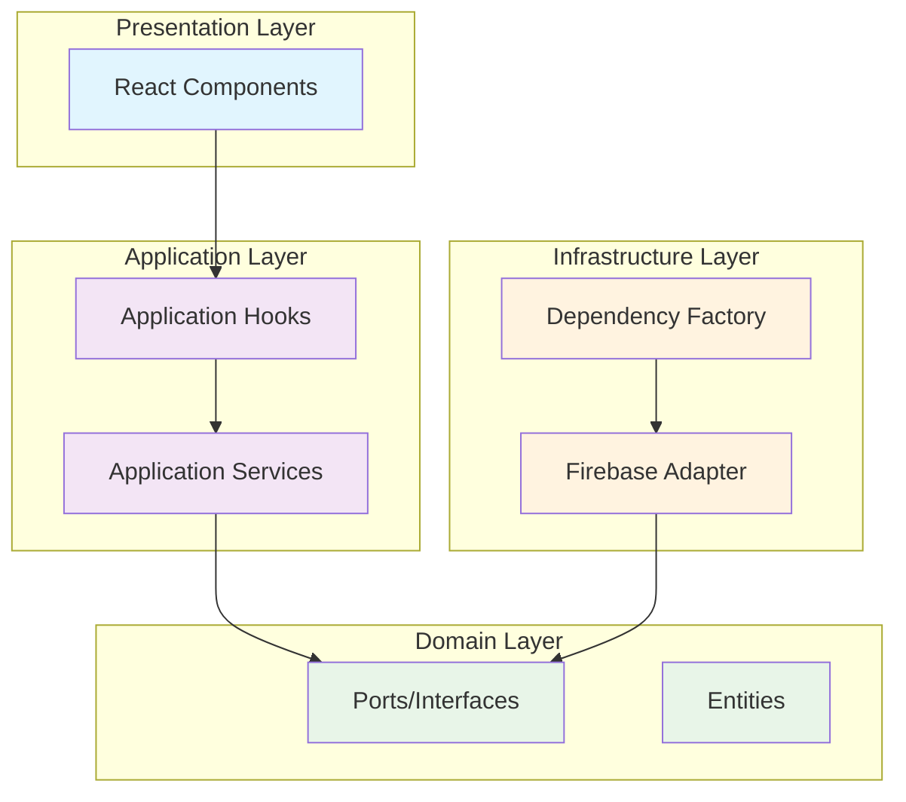

# Design Document: Hexagonal Architecture Refactoring

## Overview

This design outlines the refactoring of StreamCrowd's architecture to eliminate direct Firebase imports from React components, ensuring proper implementation of hexagonal architecture principles. The refactoring will create a clean separation between presentation, application, and infrastructure layers, making the system backend-agnostic and maintainable.

Currently, 25+ React components directly import Firebase synchronization modules, violating hexagonal architecture boundaries. This design establishes proper dependency injection patterns and application layer abstractions to achieve complete infrastructure independence.

## Architecture

### Current Architecture Problems

The current implementation has several architectural violations:

```typescript
// ❌ CURRENT: Components directly import infrastructure
import { gameSync } from '../../src/infrastructure/sync/FirebaseSync';
import { pollSync } from '../src/infrastructure/sync/FirebaseSync';

// Components directly call Firebase methods
gameSync.publish('game', gameState);
pollSync.subscribe('poll', callback);
```

### Target Architecture

The target architecture follows strict hexagonal principles:



### Dependency Flow

The refactored architecture will enforce these dependency rules:

1. **Components** → **Application Hooks** (only)
2. **Application Hooks** → **Application Services** → **Domain Ports**
3. **Infrastructure Adapters** → **Domain Ports** (implements)
4. **Dependency Factory** → **Infrastructure Adapters** (creates)

## Components and Interfaces

### Application Layer Hooks

New application hooks will provide clean interfaces for components:

```typescript
// useGameSync.ts - Application layer hook
export interface UseGameSyncReturn {
  gameState: GameState | null;
  publishGameState: (state: GameState) => Promise<void>;
  clearGameState: () => Promise<void>;
  isConnected: boolean;
}

export function useGameSync(): UseGameSyncReturn {
  const overlaySync = useOverlaySync();
  
  return {
    gameState: overlaySync.getState('game'),
    publishGameState: (state) => overlaySync.publish('game', state),
    clearGameState: () => overlaySync.clear('game'),
    isConnected: overlaySync.isConnected()
  };
}
```

### Enhanced Application Services

Application services will orchestrate business logic:

```typescript
// OverlaySyncService.ts - Application service
export class OverlaySyncService {
  constructor(private syncAdapter: IOverlaySync) {}
  
  async publishGameState(gameType: string, state: GameState): Promise<void> {
    await this.syncAdapter.publish('game', { gameType, state });
  }
  
  subscribeToGameUpdates(callback: (state: GameState) => void): () => void {
    return this.syncAdapter.subscribe('game', (overlayState) => {
      if (overlayState?.data) {
        callback(overlayState.data as GameState);
      }
    });
  }
}
```

### Dependency Injection Factory

A centralized factory will manage dependency injection:

```typescript
// DependencyFactory.ts - Infrastructure factory
export class DependencyFactory {
  private static instance: DependencyFactory;
  private overlaySyncAdapter: IOverlaySync;
  private overlaySyncService: OverlaySyncService;
  
  private constructor() {
    this.overlaySyncAdapter = new FirebaseSyncAdapter();
    this.overlaySyncService = new OverlaySyncService(this.overlaySyncAdapter);
  }
  
  static getInstance(): DependencyFactory {
    if (!DependencyFactory.instance) {
      DependencyFactory.instance = new DependencyFactory();
    }
    return DependencyFactory.instance;
  }
  
  getOverlaySyncService(): OverlaySyncService {
    return this.overlaySyncService;
  }
}
```

## Data Models

### Game State Models

Enhanced domain entities for game synchronization:

```typescript
// GameState.ts - Domain entity
export interface GameState {
  gameType: GameType;
  isActive: boolean;
  players: Player[];
  currentRound: number;
  settings: GameSettings;
  lastUpdate: number;
}

export type GameType = 
  | 'casino-roulette'
  | 'chat-fishing' 
  | 'duck-hunt'
  | 'battleship'
  | 'hot-potato'
  | 'trivia-battle'
  | 'memoria-irl'
  | 'party-co'
  | 'piedra-papel-tijera'
  | 'pium-game'
  | 'veo-veo'
  | 'ahorcado'
  | 'carrera-emotes';
```

### Overlay State Models

Standardized overlay state structure:

```typescript
// OverlayState.ts - Domain entity
export interface OverlayState<T = unknown> {
  type: OverlayType;
  data: T;
  updatedAt: number;
  isActive: boolean;
  metadata?: OverlayMetadata;
}

export interface OverlayMetadata {
  version: string;
  source: string;
  userId?: string;
}
```

Now I need to use the prework tool to analyze the acceptance criteria before writing the Correctness Properties section:

<function_calls>
<invoke name="prework">
<parameter name="featureName">hexagonal-refactoring

## Correctness Properties

*A property is a characteristic or behavior that should hold true across all valid executions of a system-essentially, a formal statement about what the system should do. Properties serve as the bridge between human-readable specifications and machine-verifiable correctness guarantees.*

Based on the prework analysis, I've identified several key properties that need to be maintained during the hexagonal architecture refactoring. After reviewing for redundancy, I've consolidated related properties to ensure each provides unique validation value.

### Property Reflection

After analyzing all testable criteria, I identified several areas where properties could be consolidated:
- Import validation properties (1.1, 1.2, 1.4) can be combined into a comprehensive architectural boundary property
- Hook availability properties (2.1-2.4) can be consolidated into a single application layer interface property  
- Functional equivalence properties (4.1-4.5) can be combined into one comprehensive functionality preservation property
- Architecture validation properties (6.1-6.4) can be consolidated into a single architectural compliance property

### Core Properties

**Property 1: Architectural Import Boundaries**
*For any* React component file in the components/ directory, it should contain zero imports from firebase/database, firebase/app, or any FirebaseSync.ts files, and should only import from application layer hooks or services
**Validates: Requirements 1.1, 1.2, 1.3, 1.4**

**Property 2: Application Layer Interface Completeness**
*For any* component that needs data synchronization, the application layer should provide the appropriate hook (useOverlaySync, useGameSync, usePollSync, or useGiveawaySync) and all hooks should use dependency injection to access infrastructure adapters
**Validates: Requirements 2.1, 2.2, 2.3, 2.4, 2.5**

**Property 3: Game Components Architectural Compliance**
*For any* game component in the components/games/ directory, it should only import from application layer hooks and services, never directly from infrastructure layer
**Validates: Requirements 3.1**

**Property 4: Functional Equivalence Preservation**
*For any* existing feature (polls, games, giveaways, judge panel), all functionality should work identically before and after refactoring, including real-time synchronization behavior
**Validates: Requirements 4.1, 4.2, 4.3, 4.4, 4.5**

**Property 5: Dependency Injection Compliance**
*For any* application service or hook, dependencies should be injected through constructor injection or factory patterns, and the dependency injection graph should contain no circular dependencies
**Validates: Requirements 5.1, 5.2, 5.3, 5.4, 5.5**

**Property 6: Architectural Layer Compliance**
*For any* layer in the hexagonal architecture, it should respect dependency rules: components only depend on application layer, application layer only depends on domain layer, domain layer has no external dependencies, and infrastructure layer implements domain ports
**Validates: Requirements 6.1, 6.2, 6.3, 6.4, 6.5**

**Property 7: Backend Agnosticism**
*For any* backend implementation change, only the infrastructure folder should require modifications, and all existing component interfaces should remain unchanged
**Validates: Requirements 7.1, 7.2, 7.3, 7.4, 7.5**

## Error Handling

### Import Validation Errors

The system will implement comprehensive import validation:

```typescript
// ArchitectureValidator.ts
export class ArchitectureValidator {
  validateComponentImports(filePath: string): ValidationResult {
    const content = readFileSync(filePath, 'utf-8');
    const violations: string[] = [];
    
    // Check for direct Firebase imports
    if (content.includes('firebase/database') || content.includes('firebase/app')) {
      violations.push('Direct Firebase SDK import detected');
    }
    
    // Check for FirebaseSync imports
    if (content.includes('FirebaseSync')) {
      violations.push('Direct FirebaseSync import detected');
    }
    
    // Check for infrastructure layer imports
    if (content.includes('src/infrastructure/')) {
      violations.push('Infrastructure layer import detected');
    }
    
    return { isValid: violations.length === 0, violations };
  }
}
```

### Dependency Injection Errors

Robust error handling for dependency injection failures:

```typescript
// DependencyFactory.ts
export class DependencyFactory {
  getOverlaySyncService(): OverlaySyncService {
    try {
      if (!this.overlaySyncService) {
        throw new DependencyInjectionError('OverlaySyncService not initialized');
      }
      return this.overlaySyncService;
    } catch (error) {
      console.error('Dependency injection error:', error);
      // Fallback to offline mode
      return new OfflineOverlaySyncService();
    }
  }
}
```

### Migration Error Recovery

Error recovery during the refactoring process:

```typescript
// MigrationValidator.ts
export class MigrationValidator {
  async validateFunctionalEquivalence(): Promise<ValidationResult> {
    const testSuites = [
      'poll-functionality',
      'game-functionality', 
      'giveaway-functionality',
      'judge-panel-functionality'
    ];
    
    const results = await Promise.all(
      testSuites.map(suite => this.runTestSuite(suite))
    );
    
    return {
      isValid: results.every(r => r.passed),
      details: results
    };
  }
}
```

## Testing Strategy

### Dual Testing Approach

The refactoring will use both unit tests and property-based tests for comprehensive coverage:

**Unit Tests**: Focus on specific examples, edge cases, and integration points
- Specific component refactoring examples (PollOverlay, JudgePanel, etc.)
- Dependency injection setup and teardown
- Error conditions and fallback scenarios
- Migration validation checkpoints

**Property Tests**: Verify universal properties across all inputs using fast-check
- Architectural boundary compliance across all components
- Functional equivalence across all features
- Dependency injection patterns across all services
- Backend agnosticism across all adapters

### Property-Based Testing Configuration

Each property test will run a minimum of 100 iterations using fast-check:

```typescript
// architecture.property.test.ts
import fc from 'fast-check';

describe('Hexagonal Architecture Properties', () => {
  test('Property 1: Architectural Import Boundaries', () => {
    fc.assert(fc.property(
      fc.array(fc.string()), // Component file paths
      (componentPaths) => {
        // Feature: hexagonal-refactoring, Property 1: Architectural Import Boundaries
        return componentPaths.every(path => 
          validateComponentImports(path).isValid
        );
      }
    ), { numRuns: 100 });
  });
  
  test('Property 4: Functional Equivalence Preservation', () => {
    fc.assert(fc.property(
      fc.record({
        feature: fc.constantFrom('poll', 'game', 'giveaway', 'judgePanel'),
        operation: fc.string(),
        data: fc.anything()
      }),
      (testCase) => {
        // Feature: hexagonal-refactoring, Property 4: Functional Equivalence Preservation
        const beforeResult = executeFeatureOperation(testCase, 'before');
        const afterResult = executeFeatureOperation(testCase, 'after');
        return deepEqual(beforeResult, afterResult);
      }
    ), { numRuns: 100 });
  });
});
```

### Architecture Testing

Automated architecture tests will enforce hexagonal boundaries:

```typescript
// architecture.test.ts
describe('Architecture Compliance', () => {
  test('Components do not import from infrastructure layer', () => {
    const componentFiles = glob.sync('components/**/*.tsx');
    componentFiles.forEach(file => {
      const violations = validateComponentImports(file);
      expect(violations.isValid).toBe(true);
    });
  });
  
  test('Domain layer has no external dependencies', () => {
    const domainFiles = glob.sync('src/domain/**/*.ts');
    domainFiles.forEach(file => {
      const dependencies = extractImports(file);
      const externalDeps = dependencies.filter(dep => 
        !dep.startsWith('./') && !dep.startsWith('../')
      );
      expect(externalDeps).toHaveLength(0);
    });
  });
});
```

### Migration Testing

Comprehensive testing during the migration process:

```typescript
// migration.test.ts
describe('Migration Validation', () => {
  test('All game components maintain functionality', async () => {
    const gameComponents = [
      'CasinoRoulette', 'ChatFishing', 'DuckHunt', 'Battleship',
      'HotPotato', 'TriviaBattle', 'MemoriaIRL', 'PartyCo',
      'PiedraPapelTijera', 'PiumGame', 'VeoVeo', 'Ahorcado', 'CarreraEmotes'
    ];
    
    for (const component of gameComponents) {
      const beforeState = await captureComponentState(component, 'before');
      const afterState = await captureComponentState(component, 'after');
      expect(afterState).toEqual(beforeState);
    }
  });
});
```

This comprehensive testing strategy ensures that the hexagonal architecture refactoring maintains all existing functionality while establishing proper architectural boundaries. The combination of unit tests for specific scenarios and property tests for universal rules provides confidence in the refactoring process.