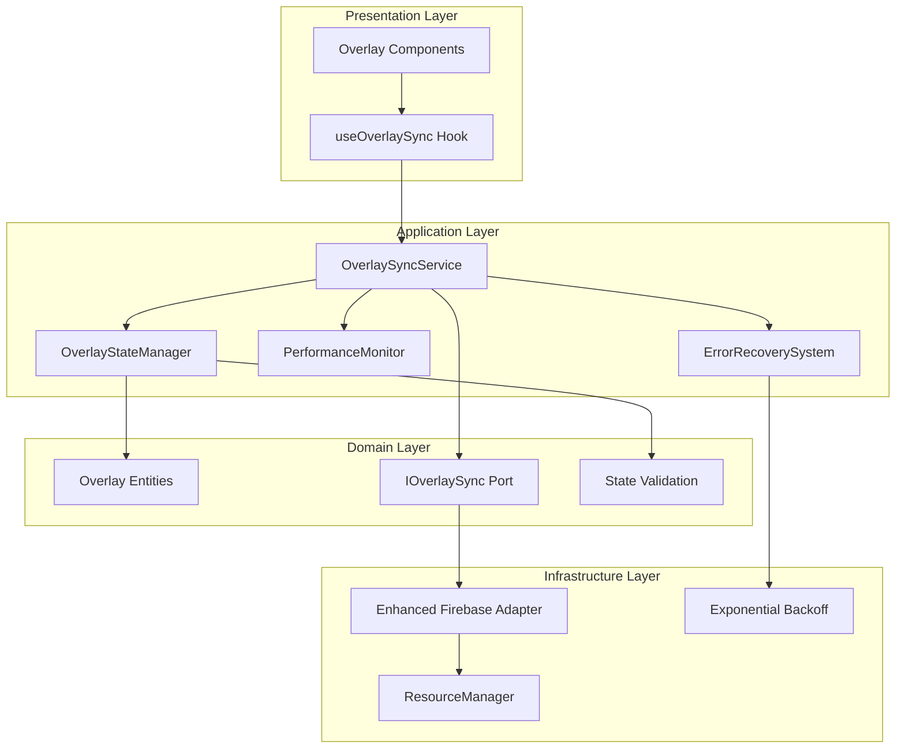

# Design Document

## Overview

The overlay synchronization system improvements will transform the current Firebase Firestore-based implementation into a robust, type-safe, and architecturally compliant solution following hexagonal architecture principles. The design addresses critical issues including type safety, error handling, performance optimization, and proper separation of concerns while maintaining backward compatibility with existing overlay components.

The improved system will provide reliable real-time synchronization for StreamCrowd's interactive features (polls, giveaways, games, predictions) across multiple devices and overlay windows, ensuring seamless streaming experiences for content creators.

## Architecture

### Hexagonal Architecture Implementation

The new overlay synchronization system follows strict hexagonal architecture principles:



### Dependency Flow

- **Presentation → Application**: React hooks consume application services
- **Application → Domain**: Services use domain entities and ports
- **Domain ← Infrastructure**: Adapters implement domain ports
- **Application → Infrastructure**: Services inject infrastructure dependencies

## Components and Interfaces

### Domain Layer Components

#### Overlay State Entities

```typescript
// src/domain/entities/OverlayState.ts
export interface BaseOverlayState {
  id: string;
  type: OverlayType;
  isActive: boolean;
  updatedAt: number;
  version: number;
  channelId: string;
}

export interface PollOverlayState extends BaseOverlayState {
  type: 'poll';
  data: {
    question: string;
    options: Array<{
      id: number;
      label: string;
      votes: number;
      color: string;
    }>;
    totalVotes: number;
    showResults: boolean;
  };
}

export interface GiveawayOverlayState extends BaseOverlayState {
  type: 'giveaway';
  data: {
    winner: string | null;
    isSpinning: boolean;
    participants: string[];
    mode: 'viewers' | 'keyword' | 'subscribers';
  };
}

export interface GameOverlayState extends BaseOverlayState {
  type: 'game';
  data: {
    gameType: string;
    state: Record<string, unknown>;
    players: string[];
    isActive: boolean;
  };
}

export interface PredictionOverlayState extends BaseOverlayState {
  type: 'prediction';
  data: {
    title: string;
    outcomes: Array<{
      id: string;
      title: string;
      color: string;
      users: number;
      channelPoints: number;
    }>;
    predictionWindow: number;
    status: 'ACTIVE' | 'LOCKED' | 'RESOLVED' | 'CANCELED';
  };
}

export type OverlayState = 
  | PollOverlayState 
  | GiveawayOverlayState 
  | GameOverlayState 
  | PredictionOverlayState;
```

#### Enhanced Port Interface

```typescript
// src/domain/ports/IOverlaySync.ts (Enhanced)
export interface IOverlaySync {
  readonly syncId: string;
  
  // Core synchronization methods
  publish<T extends OverlayState>(state: T): Promise<SyncResult>;
  subscribe<T extends OverlayState>(
    type: OverlayType, 
    callback: SyncCallback<T>
  ): SyncSubscription;
  clear(type: OverlayType): Promise<SyncResult>;
  clearAll(): Promise<SyncResult>;
  
  // Connection management
  isConnected(): boolean;
  getConnectionStatus(): ConnectionStatus;
  reconnect(): Promise<void>;
  
  // Performance monitoring
  getMetrics(): SyncMetrics;
  
  // Resource cleanup
  dispose(): void;
}

export interface SyncResult {
  success: boolean;
  error?: SyncError;
  latency?: number;
  timestamp: number;
}

export interface SyncSubscription {
  unsubscribe(): void;
  isActive(): boolean;
  getType(): OverlayType;
}

export interface SyncMetrics {
  connectionStatus: ConnectionStatus;
  averageLatency: number;
  errorRate: number;
  lastSyncTime: number;
  totalSyncs: number;
  failedSyncs: number;
}
```

### Application Layer Components

#### OverlaySyncService

The main application service orchestrating overlay synchronization:

```typescript
// src/application/services/OverlaySyncService.ts
export class OverlaySyncService {
  constructor(
    private syncAdapter: IOverlaySync,
    private stateManager: OverlayStateManager,
    private performanceMonitor: PerformanceMonitor,
    private errorRecovery: ErrorRecoverySystem,
    private resourceManager: ResourceManager
  ) {}
  
  // Public API methods
  async updateOverlayState<T extends OverlayState>(state: T): Promise<void>
  subscribeToOverlayChanges<T extends OverlayState>(
    type: OverlayType, 
    callback: (state: T | null) => void
  ): () => void
  async clearOverlay(type: OverlayType): Promise<void>
  getConnectionStatus(): ConnectionStatus
  getPerformanceMetrics(): SyncMetrics
  
  // Internal methods
  private handleSyncError(error: Error, operation: string): void
  private shouldDebounceUpdate(type: OverlayType): boolean
  private schedulePerformanceCheck(): void
}
```

#### OverlayStateManager

Handles state validation, transformation, and business logic:

```typescript
// src/application/services/OverlayStateManager.ts
export class OverlayStateManager {
  validateState<T extends OverlayState>(state: T): ValidationResult
  transformForSync<T extends OverlayState>(state: T): T
  compareStates<T extends OverlayState>(current: T, previous: T): boolean
  createStateSnapshot<T extends OverlayState>(state: T): T
  migrateStateVersion<T extends OverlayState>(state: T, targetVersion: number): T
}
```

#### PerformanceMonitor

Tracks synchronization performance and detects issues:

```typescript
// src/application/services/PerformanceMonitor.ts
export class PerformanceMonitor {
  recordSyncLatency(operation: string, latency: number): void
  recordSyncError(operation: string, error: SyncError): void
  getAverageLatency(timeWindow?: number): number
  getErrorRate(timeWindow?: number): number
  detectPerformanceIssues(): PerformanceIssue[]
  generateDiagnosticReport(): DiagnosticReport
}
```

#### ErrorRecoverySystem

Manages connection failures and retry logic:

```typescript
// src/application/services/ErrorRecoverySystem.ts
export class ErrorRecoverySystem {
  async handleConnectionFailure(error: Error): Promise<RecoveryResult>
  async attemptReconnection(): Promise<boolean>
  shouldRetryOperation(error: Error, attemptCount: number): boolean
  calculateBackoffDelay(attemptCount: number): number
  enableFallbackMode(): void
  disableFallbackMode(): void
}
```

### Infrastructure Layer Components

#### Enhanced Firebase Adapter

Improved Firebase Firestore adapter with robust error handling:

```typescript
// src/infrastructure/adapters/EnhancedFirebaseAdapter.ts
export class EnhancedFirebaseAdapter implements IOverlaySync {
  constructor(
    private config: FirebaseConfig,
    private retryLogic: RetryLogic,
    private resourceManager: ResourceManager
  ) {}
  
  // Enhanced implementation with proper error handling
  async publish<T extends OverlayState>(state: T): Promise<SyncResult>
  subscribe<T extends OverlayState>(
    type: OverlayType, 
    callback: SyncCallback<T>
  ): SyncSubscription
  
  // Connection management with exponential backoff
  private async ensureConnection(): Promise<void>
  private handleFirestoreError(error: FirestoreError): SyncError
  private createDocumentReference(channelId: string): DocumentReference
}
```

## Data Models

### State Schema Versioning

```typescript
export interface StateSchema {
  version: number;
  migrations: Record<number, (state: any) => any>;
}

export const OVERLAY_STATE_SCHEMA: StateSchema = {
  version: 2,
  migrations: {
    1: (state) => ({ ...state, version: 1 }),
    2: (state) => ({ ...state, version: 2, channelId: state.channelId || 'default' })
  }
};
```

### Performance Metrics Model

```typescript
export interface PerformanceMetrics {
  connectionStatus: 'connected' | 'disconnected' | 'reconnecting' | 'error';
  latencyStats: {
    average: number;
    p95: number;
    p99: number;
    samples: number;
  };
  errorStats: {
    total: number;
    byType: Record<string, number>;
    lastError?: {
      type: string;
      message: string;
      timestamp: number;
    };
  };
  syncStats: {
    totalOperations: number;
    successfulOperations: number;
    failedOperations: number;
    lastSyncTime: number;
  };
}
```

### Error Classification Model

```typescript
export interface SyncError {
  type: 'connection' | 'permission' | 'validation' | 'rate_limit' | 'unknown';
  code: string;
  message: string;
  isRetryable: boolean;
  requiresReauth: boolean;
  context?: Record<string, unknown>;
  timestamp: number;
}
```

Now I need to use the prework tool to analyze the acceptance criteria before writing the Correctness Properties section:

<function_calls>
<invoke name="prework">
<parameter name="featureName">overlay-sync-improvements

## Correctness Properties

*A property is a characteristic or behavior that should hold true across all valid executions of a system—essentially, a formal statement about what the system should do. Properties serve as the bridge between human-readable specifications and machine-verifiable correctness guarantees.*

Based on the prework analysis and property reflection, the following correctness properties ensure the overlay synchronization system behaves correctly across all scenarios:

### Property 1: Type Safety and Schema Compliance
*For any* overlay state object, it should conform to the defined TypeScript interfaces and include version information for schema evolution.
**Validates: Requirements 1.1, 1.4**

### Property 2: State Validation and Error Handling
*For any* state update operation, if the data is invalid, the State_Manager should reject the update and return a descriptive error message, while valid data should pass validation.
**Validates: Requirements 1.2, 1.3**

### Property 3: Serialization Round-trip Integrity
*For any* valid overlay state, serializing then deserializing should produce an equivalent state with preserved type information.
**Validates: Requirements 1.5**

### Property 4: Exponential Backoff Retry Behavior
*For any* connection failure, the Error_Recovery_System should implement exponential backoff with maximum 3 attempts, avoiding infinite loops and enabling fallback mode when all retries fail.
**Validates: Requirements 2.1, 2.2, 2.4**

### Property 5: Automatic Reconnection and State Sync
*For any* network restoration event, the Overlay_Sync_Service should automatically reconnect and synchronize the latest state.
**Validates: Requirements 2.3**

### Property 6: Environment-Appropriate Error Logging
*For any* error occurrence, the Error_Recovery_System should log detailed information for debugging while avoiding console output in production environments.
**Validates: Requirements 2.5**

### Property 7: Performance Optimization Through State Comparison
*For any* overlay state update, if the new state is identical to the previous state, the system should skip synchronization and prevent unnecessary operations.
**Validates: Requirements 3.1, 3.5**

### Property 8: Update Debouncing for Rapid Changes
*For any* sequence of rapid state changes, the Overlay_Sync_Service should debounce updates to reduce Firebase write operations while maintaining data consistency.
**Validates: Requirements 3.2**

### Property 9: Resource Cleanup on Component Unmount
*For any* component unmount event, the Resource_Manager should properly cleanup all Firebase subscriptions and clear pending timers.
**Validates: Requirements 3.3**

### Property 10: Comprehensive Performance Monitoring
*For any* synchronization operation, the Performance_Monitor should track latency, error rates, and connection status, providing diagnostics when performance degrades.
**Validates: Requirements 3.4, 5.1, 5.4, 7.4**

### Property 11: Architectural Dependency Compliance
*For any* Firebase operation, the Overlay_Sync_Service should delegate to the Firebase_Adapter while maintaining proper hexagonal architecture dependency flow.
**Validates: Requirements 4.2**

### Property 12: Error Categorization and Actionable Messages
*For any* synchronization error, the Error_Recovery_System should categorize the error by type and provide actionable error messages.
**Validates: Requirements 5.2**

### Property 13: Audit Logging for State Changes
*For any* overlay state change, the system should maintain audit logs with timestamps and user context.
**Validates: Requirements 5.5**

### Property 14: Schema Compatibility and Migration
*For any* overlay state data, the Firebase_Adapter should support both current and new schema formats, with automatic data format conversion during migration.
**Validates: Requirements 6.3, 6.4**

### Property 15: Real-time Synchronization Performance
*For any* overlay state change, updates should propagate to all connected clients within 100 milliseconds, ensuring simultaneous delivery across multiple devices.
**Validates: Requirements 7.1, 7.3**

### Property 16: Critical Update Prioritization
*For any* network degradation scenario, the system should prioritize critical overlay updates over non-essential data.
**Validates: Requirements 7.5**

## Error Handling

### Error Classification System

The system implements a comprehensive error classification approach:

```typescript
export enum SyncErrorType {
  CONNECTION = 'connection',
  PERMISSION = 'permission', 
  VALIDATION = 'validation',
  RATE_LIMIT = 'rate_limit',
  SCHEMA_MISMATCH = 'schema_mismatch',
  TIMEOUT = 'timeout',
  UNKNOWN = 'unknown'
}

export interface ErrorHandlingStrategy {
  isRetryable: boolean;
  maxRetries: number;
  backoffStrategy: 'exponential' | 'linear' | 'fixed';
  fallbackAction: 'local_storage' | 'cache' | 'disable_feature';
  userNotification: boolean;
}
```

### Retry Logic Implementation

The error recovery system implements sophisticated retry logic:

1. **Exponential Backoff**: Delays increase exponentially (1s, 2s, 4s) with jitter
2. **Circuit Breaker**: Prevents cascading failures by temporarily disabling failing operations
3. **Graceful Degradation**: Falls back to local state management when remote sync fails
4. **Smart Recovery**: Automatically resumes sync when connectivity is restored

### Error Monitoring and Alerting

- Real-time error rate monitoring with configurable thresholds
- Automatic alerting when error rates exceed acceptable limits
- Detailed error context including network conditions and Firebase response times
- Integration with existing logging infrastructure for debugging

## Testing Strategy

### Dual Testing Approach

The overlay synchronization system requires both unit testing and property-based testing for comprehensive coverage:

**Unit Tests Focus:**
- Specific error scenarios and edge cases
- Integration points between components
- Mock Firebase service interactions
- Component lifecycle and cleanup behavior

**Property-Based Tests Focus:**
- Universal properties across all overlay state types
- State synchronization behavior with randomized inputs
- Error handling and recovery across various failure scenarios
- Performance characteristics under different load conditions

### Property-Based Testing Configuration

- **Testing Library**: fast-check for TypeScript property-based testing
- **Test Iterations**: Minimum 100 iterations per property test
- **Test Tagging**: Each property test references its design document property
- **Tag Format**: `Feature: overlay-sync-improvements, Property {number}: {property_text}`

### Test Coverage Requirements

1. **Domain Layer**: 100% coverage of entity validation and business logic
2. **Application Layer**: Comprehensive service method coverage with mock dependencies
3. **Infrastructure Layer**: Integration tests with mock Firebase services
4. **End-to-End**: Multi-device synchronization scenarios with real Firebase instances

### Testing Infrastructure

```typescript
// Example property test structure
describe('Overlay Sync Properties', () => {
  it('Property 1: Type Safety and Schema Compliance', () => {
    fc.assert(fc.property(
      overlayStateArbitrary,
      (state) => {
        // Feature: overlay-sync-improvements, Property 1: Type Safety and Schema Compliance
        expect(validateOverlayStateSchema(state)).toBe(true);
        expect(state.version).toBeGreaterThan(0);
        expect(state.channelId).toBeDefined();
      }
    ), { numRuns: 100 });
  });
});
```

### Mock Strategy

- **Firebase Mocks**: Comprehensive Firestore mock with realistic latency simulation
- **Network Condition Simulation**: Configurable network failure and recovery scenarios
- **Time-based Testing**: Mock timers for testing debouncing and retry logic
- **Multi-device Simulation**: Mock multiple client connections for synchronization testing