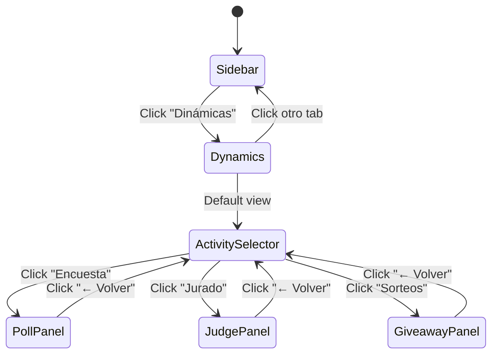

# Design Document: Sidebar Dynamics Grouping

## Overview

Esta feature reorganiza el sidebar izquierdo de la aplicación, agrupando Encuesta, Jurado y Sorteos bajo una nueva sección "Dinámicas". Se implementará un nuevo componente `ActivitySelector` que muestra tarjetas seleccionables, y se modificará el estado de navegación para soportar la nueva jerarquía.

## Architecture

### Cambios en la Estructura de Navegación

```
Antes:                          Después:
─────────────────               ─────────────────
leftTab: 'poll'                 leftTab: 'dynamics'
leftTab: 'judge'                  └─ dynamicsView: 'selector' | 'poll' | 'judge' | 'giveaway'
leftTab: 'giveaway'             leftTab: 'games'
leftTab: 'games'                leftTab: 'obs'
leftTab: 'obs'                  leftTab: 'gallery'
leftTab: 'gallery'              leftTab: 'data'
leftTab: 'data'
```

### Flujo de Navegación



## Components and Interfaces

### Nuevos Componentes

#### 1. ActivitySelector

```typescript
// components/ActivitySelector.tsx

interface ActivityCardData {
  id: 'poll' | 'judge' | 'giveaway';
  icon: React.ReactNode;
  title: string;
  description: string;
  color: string;
}

interface ActivitySelectorProps {
  onSelectActivity: (activity: 'poll' | 'judge' | 'giveaway') => void;
}

const ActivitySelector: React.FC<ActivitySelectorProps>
```

#### 2. ActivityCard

```typescript
// Subcomponente dentro de ActivitySelector

interface ActivityCardProps {
  icon: React.ReactNode;
  title: string;
  description: string;
  color: string;
  onClick: () => void;
}

const ActivityCard: React.FC<ActivityCardProps>
```

#### 3. DynamicsPanel

```typescript
// components/DynamicsPanel.tsx

interface DynamicsPanelProps {
  // Props existentes de cada panel
  chatMessages: TwitchMessage[];
  isConnected: boolean;
  // ... otros props compartidos
  
  // Nuevo: callback para volver al selector
  onBack: () => void;
}

const DynamicsPanel: React.FC<DynamicsPanelProps>
```

### Modificaciones a Componentes Existentes

#### App.tsx

```typescript
// Cambios en el estado
const [leftTab, setLeftTab] = useState<'dynamics' | 'games' | 'obs' | 'gallery' | 'data'>('dynamics');
const [dynamicsView, setDynamicsView] = useState<'selector' | 'poll' | 'judge' | 'giveaway'>('selector');

// Función para manejar navegación de dinámicas
const handleDynamicsNavigation = (view: 'selector' | 'poll' | 'judge' | 'giveaway') => {
  setDynamicsView(view);
};

// Cuando se cambia de tab, volver al selector
useEffect(() => {
  if (leftTab !== 'dynamics') {
    // Opcionalmente resetear a selector cuando se sale
  }
}, [leftTab]);
```

### Estructura de Archivos

```
components/
├── ActivitySelector.tsx      # Nuevo - Selector de actividades
├── DynamicsPanel.tsx         # Nuevo - Wrapper para dinámicas
├── PollCreator.tsx           # Existente - sin cambios internos
├── JudgePanel.tsx            # Existente - sin cambios internos
├── GiveawayHub.tsx           # Existente - sin cambios internos
└── ...
```

## Data Models

### Tipos de Navegación

```typescript
// types.ts o types/navigation.ts

export type LeftTab = 'dynamics' | 'games' | 'obs' | 'gallery' | 'data';

export type DynamicsView = 'selector' | 'poll' | 'judge' | 'giveaway';

export interface ActivityConfig {
  id: DynamicsView;
  icon: string;
  title: string;
  description: string;
  color: string;
  component: React.ComponentType<any>;
}
```

### Configuración de Actividades

```typescript
const ACTIVITIES: ActivityConfig[] = [
  {
    id: 'poll',
    icon: 'VoteIcon',
    title: 'Encuesta',
    description: 'Crea votaciones interactivas para tu audiencia',
    color: '#a970ff', // Twitch purple
  },
  {
    id: 'judge',
    icon: 'Trophy',
    title: 'Jurado',
    description: 'Panel de puntuación en vivo',
    color: '#fbbf24', // Amber
  },
  {
    id: 'giveaway',
    icon: 'Gift',
    title: 'Sorteos',
    description: 'Sorteos y giveaways para tu comunidad',
    color: '#f472b6', // Pink
  },
];
```

## Correctness Properties

*A property is a characteristic or behavior that should hold true across all valid executions of a system—essentially, a formal statement about what the system should do. Properties serve as the bridge between human-readable specifications and machine-verifiable correctness guarantees.*

### Property 1: Activity Selector Renders Correctly

*For any* render of the ActivitySelector component, it SHALL display exactly 3 ActivityCards, each containing an icon element, a title text, and a description text.

**Validates: Requirements 1.1, 1.2**

### Property 2: Activity Navigation Works Correctly

*For any* ActivityCard click event, the system SHALL update the dynamicsView state to match the clicked activity's id, and the corresponding panel component SHALL be rendered.

**Validates: Requirements 1.3, 2.1**

### Property 3: Back Navigation Returns to Selector

*For any* dynamicsView state that is not 'selector', clicking the back button SHALL set dynamicsView to 'selector', and the ActivitySelector component SHALL be rendered.

**Validates: Requirements 2.2**

### Property 4: State Persistence During Navigation

*For any* sequence of navigation actions (selecting an activity, navigating to another tab, returning to dynamics), the in-progress data within each activity panel SHALL be preserved.

**Validates: Requirements 4.1, 4.2, 4.3**

### Property 5: Dynamics Tab Remains Active During Sub-Navigation

*For any* dynamicsView value (selector, poll, judge, or giveaway), the Dinámicas tab in the sidebar SHALL have the active styling applied.

**Validates: Requirements 5.3**

### Property 6: Keyboard Navigation Accessibility

*For any* ActivityCard, it SHALL be focusable via Tab key, and when focused, pressing Enter or Space SHALL trigger the onClick handler.

**Validates: Requirements 7.1, 7.2, 7.4**

### Property 7: Demo Tour Navigation Integration

*For any* demo tour step that targets poll, judge, or giveaway functionality, the tour SHALL first navigate to leftTab='dynamics' and then set the appropriate dynamicsView.

**Validates: Requirements 6.1, 6.2, 6.3**

## Error Handling

### Navegación Inválida

```typescript
// Si se intenta navegar a una vista inválida, volver al selector
const handleDynamicsNavigation = (view: string) => {
  const validViews = ['selector', 'poll', 'judge', 'giveaway'];
  if (validViews.includes(view)) {
    setDynamicsView(view as DynamicsView);
  } else {
    console.warn(`Invalid dynamics view: ${view}, defaulting to selector`);
    setDynamicsView('selector');
  }
};
```

### Estado Inconsistente

```typescript
// Asegurar consistencia entre leftTab y dynamicsView
useEffect(() => {
  if (leftTab !== 'dynamics' && dynamicsView !== 'selector') {
    // Cuando se sale de dynamics, opcionalmente resetear
    // Esto es configurable según el requisito 4.2
  }
}, [leftTab]);
```

## Testing Strategy

### Unit Tests

1. **ActivitySelector Component**
   - Renderiza 3 cards con contenido correcto
   - Llama onSelectActivity con el id correcto al hacer click
   - Cards son focusables y responden a Enter/Space

2. **DynamicsPanel Component**
   - Renderiza el panel correcto según dynamicsView
   - Muestra botón de volver cuando no está en selector
   - Llama onBack al hacer click en volver

3. **Navigation State**
   - leftTab cambia correctamente
   - dynamicsView se actualiza al seleccionar actividad
   - Estado se preserva durante navegación

### Property-Based Tests

Se utilizará **fast-check** para los tests de propiedades.

1. **Property 1**: Generar renders aleatorios y verificar estructura de cards
2. **Property 2**: Generar secuencias de clicks y verificar navegación
3. **Property 3**: Generar estados y verificar comportamiento del back button
4. **Property 4**: Generar secuencias de navegación y verificar persistencia
5. **Property 5**: Generar dynamicsView values y verificar estado activo del tab
6. **Property 6**: Generar eventos de teclado y verificar accesibilidad
7. **Property 7**: Generar pasos del tour y verificar navegación correcta

### Integration Tests

1. Flujo completo: Sidebar → Dinámicas → Encuesta → Volver → Jurado
2. Demo tour con nueva estructura
3. Navegación móvil con nueva estructura
