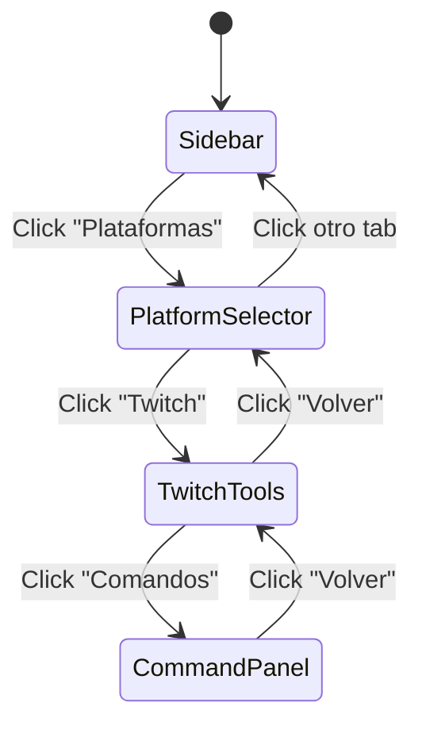

# Design Document: Sidebar Platforms Section

## Overview

Esta feature añade una nueva sección "Plataformas" al sidebar, siguiendo el mismo patrón de diseño que "Dinámicas". Implementa una navegación jerárquica de 3 niveles: Plataformas → Herramientas de Plataforma → Panel de Herramienta. Inicialmente solo incluye Twitch con el CommandPanel existente, pero la arquitectura soporta expansión futura.

## Architecture

### Estructura de Navegación

```
Plataformas (leftTab: 'platforms')
├── Platform Selector (platformsView: 'selector')
│   └── Twitch Card
│       └── Tool Selector (platformsView: 'twitch')
│           ├── Comandos → CommandPanel (platformsTool: 'commands')
│           ├── Predicciones (próximamente)
│           └── Channel Points (próximamente)
└── (Futuro: YouTube, Kick, etc.)
```

### Cambios en el Estado de Navegación

```typescript
// Estado actual (después de Dinámicas)
const [leftTab, setLeftTab] = useState<'dynamics' | 'games' | 'obs' | 'gallery' | 'data'>('dynamics');

// Nuevo estado
const [leftTab, setLeftTab] = useState<'dynamics' | 'games' | 'platforms' | 'obs' | 'gallery' | 'data'>('dynamics');
const [platformsView, setPlatformsView] = useState<'selector' | 'twitch'>('selector');
const [platformsTool, setPlatformsTool] = useState<'none' | 'commands' | 'predictions' | 'channelpoints'>('none');
```

### Flujo de Navegación



## Components and Interfaces

### Nuevos Componentes

#### 1. PlatformSelector

```typescript
// components/PlatformSelector.tsx

interface PlatformConfig {
  id: string;
  icon: React.ReactNode;
  title: string;
  description: string;
  color: string;
  enabled: boolean;
}

interface PlatformSelectorProps {
  platforms: PlatformConfig[];
  onSelectPlatform: (platformId: string) => void;
}

const PlatformSelector: React.FC<PlatformSelectorProps>
```

#### 2. TwitchToolSelector

```typescript
// components/TwitchToolSelector.tsx

interface ToolConfig {
  id: string;
  icon: React.ReactNode;
  title: string;
  description: string;
  color: string;
  enabled: boolean;
  comingSoon?: boolean;
}

interface TwitchToolSelectorProps {
  tools: ToolConfig[];
  onSelectTool: (toolId: string) => void;
  onBack: () => void;
}

const TwitchToolSelector: React.FC<TwitchToolSelectorProps>
```

#### 3. PlatformsPanel

```typescript
// components/PlatformsPanel.tsx

interface PlatformsPanelProps {
  view: 'selector' | 'twitch';
  tool: 'none' | 'commands' | 'predictions' | 'channelpoints';
  onNavigate: (view: string, tool?: string) => void;
  onBack: () => void;
  // Props para CommandPanel
  chatMessages: TwitchMessage[];
  isConnected: boolean;
}

const PlatformsPanel: React.FC<PlatformsPanelProps>
```

### Configuración de Plataformas y Herramientas

```typescript
// config/platforms.ts

export const PLATFORMS: PlatformConfig[] = [
  {
    id: 'twitch',
    icon: <TwitchIcon />, // o usar lucide-react similar
    title: 'Twitch',
    description: 'Comandos, predicciones y más',
    color: '#9146FF',
    enabled: true,
  },
  // Futuro:
  // { id: 'youtube', title: 'YouTube', enabled: false, comingSoon: true },
  // { id: 'kick', title: 'Kick', enabled: false, comingSoon: true },
];

export const TWITCH_TOOLS: ToolConfig[] = [
  {
    id: 'commands',
    icon: <Terminal />,
    title: 'Comandos',
    description: 'Comandos personalizados de chat',
    color: '#a970ff',
    enabled: true,
  },
  {
    id: 'predictions',
    icon: <TrendingUp />,
    title: 'Predicciones',
    description: 'Predicciones de Twitch',
    color: '#00f0f0',
    enabled: false,
    comingSoon: true,
  },
  {
    id: 'channelpoints',
    icon: <Coins />,
    title: 'Channel Points',
    description: 'Recompensas de puntos',
    color: '#fbbf24',
    enabled: false,
    comingSoon: true,
  },
];
```

### Estructura de Archivos

```
components/
├── PlatformSelector.tsx      # Nuevo - Selector de plataformas
├── TwitchToolSelector.tsx    # Nuevo - Selector de herramientas Twitch
├── PlatformsPanel.tsx        # Nuevo - Wrapper principal
├── CommandPanel.tsx          # Existente - se integra sin cambios
└── ...

config/
└── platforms.ts              # Nuevo - Configuración de plataformas y tools
```

## Data Models

### Tipos de Navegación

```typescript
// types/navigation.ts (extender)

export type LeftTab = 'dynamics' | 'games' | 'platforms' | 'obs' | 'gallery' | 'data';

export type PlatformsView = 'selector' | 'twitch'; // Expandir con 'youtube', 'kick' en futuro

export type PlatformsTool = 'none' | 'commands' | 'predictions' | 'channelpoints';

export interface PlatformConfig {
  id: string;
  icon: React.ReactNode;
  title: string;
  description: string;
  color: string;
  enabled: boolean;
  comingSoon?: boolean;
}

export interface ToolConfig {
  id: string;
  icon: React.ReactNode;
  title: string;
  description: string;
  color: string;
  enabled: boolean;
  comingSoon?: boolean;
}
```

## Correctness Properties

*A property is a characteristic or behavior that should hold true across all valid executions of a system—essentially, a formal statement about what the system should do. Properties serve as the bridge between human-readable specifications and machine-verifiable correctness guarantees.*

### Property 1: Platform Navigation Works Correctly

*For any* click on the Plataformas tab, the PlatformSelector SHALL be displayed. *For any* click on an enabled PlatformCard, the system SHALL navigate to that platform's ToolSelector.

**Validates: Requirements 1.2, 1.3, 2.3**

### Property 2: Tool Navigation Works Correctly

*For any* enabled ToolCard click, the system SHALL navigate to the corresponding tool panel. *For any* disabled (comingSoon) ToolCard, clicking SHALL have no effect.

**Validates: Requirements 3.1, 3.4, 4.1**

### Property 3: Coming Soon Tools Are Non-Interactive

*For any* tool marked with `comingSoon: true`, the ToolCard SHALL display a "Próximamente" badge and clicking SHALL not trigger navigation.

**Validates: Requirements 3.5**

### Property 4: Hierarchical Back Navigation

*For any* navigation depth (tool panel → tool selector → platform selector), clicking the back button SHALL return to the previous level in the hierarchy.

**Validates: Requirements 5.1, 5.2, 5.3**

### Property 5: Platforms Tab Remains Active

*For any* platformsView or platformsTool value, the Plataformas tab in the sidebar SHALL maintain active styling.

**Validates: Requirements 5.4**

### Property 6: State Persistence During Navigation

*For any* sequence of navigation within Plataformas, the data in CommandPanel (or other tool panels) SHALL be preserved when navigating away and back.

**Validates: Requirements 4.3, 4.4**

### Property 7: Keyboard Navigation Accessibility

*For any* PlatformCard or ToolCard, it SHALL be focusable via Tab key, and when focused, pressing Enter or Space SHALL trigger the onClick handler (if enabled).

**Validates: Requirements 7.1, 7.2, 7.3**

## Error Handling

### Navegación a Plataforma/Herramienta Inválida

```typescript
const handlePlatformNavigation = (platformId: string) => {
  const platform = PLATFORMS.find(p => p.id === platformId);
  if (!platform || !platform.enabled) {
    console.warn(`Invalid or disabled platform: ${platformId}`);
    return;
  }
  setPlatformsView(platformId as PlatformsView);
};

const handleToolNavigation = (toolId: string) => {
  const tool = TWITCH_TOOLS.find(t => t.id === toolId);
  if (!tool || !tool.enabled || tool.comingSoon) {
    console.warn(`Invalid or disabled tool: ${toolId}`);
    return;
  }
  setPlatformsTool(toolId as PlatformsTool);
};
```

### Reset de Estado al Cambiar de Tab

```typescript
useEffect(() => {
  if (leftTab !== 'platforms') {
    // Opcionalmente resetear a selector cuando se sale
    // setPlatformsView('selector');
    // setPlatformsTool('none');
  }
}, [leftTab]);
```

## Testing Strategy

### Unit Tests

1. **PlatformSelector Component**
   - Renderiza cards para cada plataforma habilitada
   - Llama onSelectPlatform con el id correcto
   - No renderiza plataformas deshabilitadas (o las muestra como coming soon)

2. **TwitchToolSelector Component**
   - Renderiza todas las herramientas
   - Herramientas coming soon muestran badge y no son clickeables
   - Llama onSelectTool solo para herramientas habilitadas
   - Muestra botón de volver

3. **PlatformsPanel Component**
   - Renderiza el componente correcto según view y tool
   - Maneja navegación jerárquica correctamente

### Property-Based Tests

Se utilizará **fast-check** para los tests de propiedades.

1. **Property 1**: Generar clicks en plataformas y verificar navegación
2. **Property 2**: Generar clicks en herramientas y verificar navegación
3. **Property 3**: Verificar que tools coming soon no navegan
4. **Property 4**: Generar secuencias de navegación y verificar back
5. **Property 5**: Generar estados y verificar tab activo
6. **Property 6**: Generar navegación y verificar persistencia
7. **Property 7**: Generar eventos de teclado y verificar accesibilidad

### Integration Tests

1. Flujo completo: Sidebar → Plataformas → Twitch → Comandos → Volver → Volver
2. Verificar que CommandPanel funciona correctamente dentro de la nueva estructura
3. Verificar accesibilidad con teclado en toda la jerarquía
