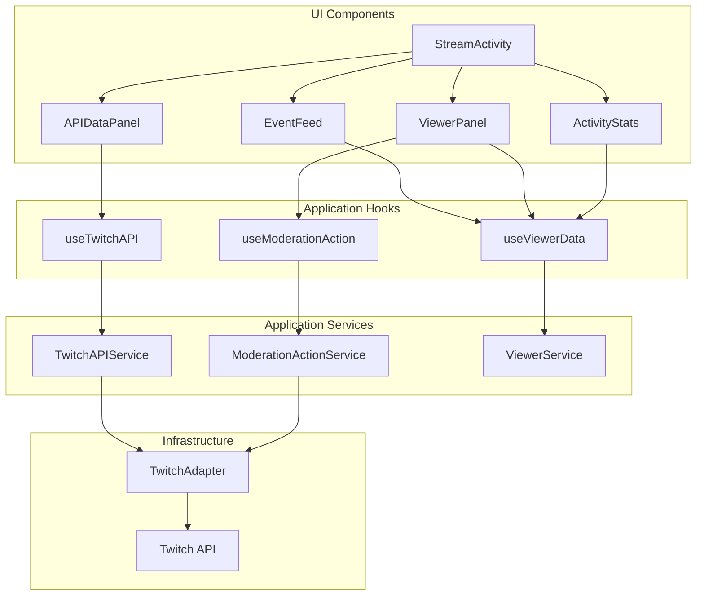

# Design Document: Stream Activity Refactor

## Overview

Este documento describe el diseño para refactorizar el componente `StreamActivity` (~3700 líneas) en una arquitectura más limpia y mantenible. El refactor sigue los principios de arquitectura hexagonal ya establecidos en el proyecto, extrayendo lógica de negocio a servicios y dividiendo el componente monolítico en subcomponentes especializados.

## Architecture

### Capas

```
┌─────────────────────────────────────────────────────────────────┐
│                    Presentation Layer                            │
│  ┌──────────────┐ ┌──────────────┐ ┌──────────────┐ ┌─────────┐ │
│  │  EventFeed   │ │ ViewerPanel  │ │ APIDataPanel │ │ Stats   │ │
│  └──────────────┘ └──────────────┘ └──────────────┘ └─────────┘ │
│                           │                                      │
│                    StreamActivity (orchestrator)                 │
└─────────────────────────────────────────────────────────────────┘
                            │
┌─────────────────────────────────────────────────────────────────┐
│                    Application Layer                             │
│  ┌──────────────────┐ ┌────────────────────┐ ┌───────────────┐  │
│  │ useTwitchAPI     │ │ useModerationAction│ │ useViewerData │  │
│  └──────────────────┘ └────────────────────┘ └───────────────┘  │
│                           │                                      │
│  ┌──────────────────┐ ┌────────────────────┐ ┌───────────────┐  │
│  │ TwitchAPIService │ │ModerationActionSvc │ │ ViewerService │  │
│  └──────────────────┘ └────────────────────┘ └───────────────┘  │
└─────────────────────────────────────────────────────────────────┘
                            │
┌─────────────────────────────────────────────────────────────────┐
│                    Infrastructure Layer                          │
│  ┌──────────────────────────────────────────────────────────┐   │
│  │                    TwitchAdapter                          │   │
│  │  (ya existente - se extiende con nuevos métodos)         │   │
│  └──────────────────────────────────────────────────────────┘   │
└─────────────────────────────────────────────────────────────────┘
```

### Flujo de datos



## Components and Interfaces

### TwitchAPIService

Servicio para llamadas a la API de Twitch que requieren datos del canal.

```typescript
// src/application/services/TwitchAPIService.ts

interface TwitchAPIError {
  code: string;
  status: number;
  message: string;
  solution: string;
  link?: string;
}

interface Follower {
  username: string;
  displayName: string;
  followedAt: string;
}

interface Subscriber {
  username: string;
  displayName: string;
  tier: '1000' | '2000' | '3000' | 'Prime';
  isGift: boolean;
  gifterId?: string;
}

interface BitsLeader {
  rank: number;
  username: string;
  displayName: string;
  bits: number;
}

interface Clip {
  id: string;
  title: string;
  url: string;
  thumbnailUrl: string;
  viewCount: number;
  creatorName: string;
  createdAt: string;
  duration: number;
}

interface Video {
  id: string;
  title: string;
  url: string;
  thumbnailUrl: string;
  viewCount: number;
  type: 'archive' | 'highlight' | 'upload';
  duration: string;
  createdAt: string;
}

interface Moderator {
  userId: string;
  username: string;
  displayName: string;
}

interface VIP {
  userId: string;
  username: string;
  displayName: string;
}

interface Chatter {
  userId: string;
  username: string;
  displayName: string;
}

type BitsPeriod = 'day' | 'week' | 'month' | 'year' | 'all';

interface TwitchAPIService {
  // Followers
  getFollowers(broadcasterId: string, limit?: number): Promise<Follower[] | TwitchAPIError>;
  
  // Subscribers
  getSubscribers(broadcasterId: string, limit?: number): Promise<Subscriber[] | TwitchAPIError>;
  
  // Bits
  getBitsLeaderboard(broadcasterId: string, period?: BitsPeriod): Promise<BitsLeader[] | TwitchAPIError>;
  
  // Clips
  getClips(broadcasterId: string, startDate?: string, endDate?: string): Promise<Clip[] | TwitchAPIError>;
  
  // Videos
  getVideos(broadcasterId: string, type?: 'archive' | 'highlight' | 'upload' | 'all'): Promise<Video[] | TwitchAPIError>;
  
  // Moderators
  getModerators(broadcasterId: string): Promise<Moderator[] | TwitchAPIError>;
  
  // VIPs
  getVIPs(broadcasterId: string): Promise<VIP[] | TwitchAPIError>;
  
  // Chatters
  getChatters(broadcasterId: string): Promise<Chatter[] | TwitchAPIError>;
  
  // Error parsing
  parseError(status: number, body?: string, dataType?: string): TwitchAPIError;
}
```

### ModerationActionService

Servicio para ejecutar acciones de moderación.

```typescript
// src/application/services/ModerationActionService.ts

type AnnouncementColor = 'blue' | 'green' | 'orange' | 'purple' | 'primary';

interface ModerationResult {
  success: boolean;
  message: string;
  error?: TwitchAPIError;
}

interface ModerationActionService {
  // Timeout
  timeoutUser(
    broadcasterId: string, 
    userId: string, 
    duration: number, 
    reason?: string
  ): Promise<ModerationResult>;
  
  // Ban
  banUser(
    broadcasterId: string, 
    userId: string, 
    reason?: string
  ): Promise<ModerationResult>;
  
  // Unban
  unbanUser(
    broadcasterId: string, 
    userId: string
  ): Promise<ModerationResult>;
  
  // VIP
  addVIP(broadcasterId: string, userId: string): Promise<ModerationResult>;
  removeVIP(broadcasterId: string, userId: string): Promise<ModerationResult>;
  
  // Announcements
  sendAnnouncement(
    broadcasterId: string, 
    message: string, 
    color?: AnnouncementColor
  ): Promise<ModerationResult>;
}
```

### ViewerService

Servicio para agregar y gestionar datos de viewers.

```typescript
// src/application/services/ViewerService.ts

interface ViewerData {
  username: string;
  displayName?: string;
  
  // Activity counts
  totalActivity: number;
  follows: number;
  votes: number;
  
  // Subscription data
  subs: number;
  resubs: number;
  totalSubMonths: number;
  currentTier?: '1000' | '2000' | '3000';
  
  // Gifts
  giftsGiven: number;
  giftsReceived: number;
  
  // Bits
  totalBits: number;
  
  // Moderation
  bans: number;
  timeouts: number;
  totalTimeoutSeconds: number;
  
  // Timestamps
  firstSeen: number;
  lastSeen: number;
  
  // Event history
  events: StreamEvent[];
}

type ViewerSortBy = 'activity' | 'bits' | 'subs' | 'bans';

interface ViewerService {
  // Event processing
  processEvent(event: StreamEvent): void;
  processEvents(events: StreamEvent[]): void;
  
  // Viewer data
  getViewer(username: string): ViewerData | null;
  getAllViewers(): ViewerData[];
  
  // Filtering and sorting
  searchViewers(query: string): ViewerData[];
  sortViewers(viewers: ViewerData[], sortBy: ViewerSortBy): ViewerData[];
  
  // Statistics
  getViewerCount(): number;
  getTopViewers(sortBy: ViewerSortBy, limit?: number): ViewerData[];
  
  // Reset
  clear(): void;
}
```

### UI Subcomponents

#### EventFeed

```typescript
// components/activity/EventFeed.tsx

interface EventGroup {
  type: StreamEventType;
  events: StreamEvent[];
  count: number;
  startTime: number;
  endTime: number;
}

interface EventFeedProps {
  events: StreamEvent[];
  pollOptions?: PollOption[];
  filters: Set<StreamEventType>;
  onFilterChange: (filters: Set<StreamEventType>) => void;
  groupingWindowMs?: number; // Default: 120000 (2 min)
}

// Features:
// - Groups similar events within time window
// - Horizontal scrollable filter chips
// - Smooth entry animations
// - Auto-scroll with pause button
// - Empty state with illustration
```

#### ViewerPanel

```typescript
// components/activity/ViewerPanel.tsx

interface ViewerPanelProps {
  viewers: ViewerData[];
  liveChatters: Chatter[];
  selectedViewer: string | null;
  onSelectViewer: (username: string | null) => void;
  onModerationAction: (action: ModerationAction) => void;
  authToken?: string;
}

// Features:
// - Tabs: "En vivo" / "Historial"
// - Search with debounce
// - Sort dropdown
// - Viewer cards with badges
// - Moderation drawer/modal
```

#### APIDataPanel

```typescript
// components/activity/APIDataPanel.tsx

interface APIDataPanelProps {
  authToken?: string;
  broadcasterId?: string;
  channelName?: string;
}

// Features:
// - Cards for each data type (followers, subs, bits, clips, videos, mods, VIPs)
// - Loading states
// - Error display with solutions
// - Scope indicators
// - Date range filters for clips
// - Period selector for bits
```

#### ActivityStats

```typescript
// components/activity/ActivityStats.tsx

interface ActivityStatsProps {
  stats: {
    follows: number;
    subs: number;
    resubs: number;
    gifts: number;
    raids: number;
    bits: number;
    votes: number;
    bans: number;
    timeouts: number;
  };
  expanded?: boolean;
  onToggleExpand?: () => void;
}

// Features:
// - Large stat cards for main metrics
// - Collapsible secondary stats
// - Color-coded by event type
// - Mini progress bars for comparison
```

## Data Models

### Event Grouping

```typescript
interface EventGroupingConfig {
  windowMs: number;        // Time window for grouping (default: 2 min)
  minGroupSize: number;    // Minimum events to form a group (default: 2)
  groupableTypes: Set<StreamEventType>; // Types that can be grouped
}

// Groupable types: follow, vote
// Non-groupable: sub, resub, gift, raid, bits, ban, timeout (these are important individually)
```

### Tab State

```typescript
interface ActivityTabState {
  activeTab: 'live' | 'viewers' | 'api' | 'history';
  viewerTab: 'live' | 'history';
  viewerSort: ViewerSortBy;
  viewerSearch: string;
  selectedViewer: string | null;
  eventFilters: Set<StreamEventType>;
  historyDate: string | null;
}
```

## Correctness Properties

*A property is a characteristic or behavior that should hold true across all valid executions of a system-essentially, a formal statement about what the system should do. Properties serve as the bridge between human-readable specifications and machine-verifiable correctness guarantees.*

### Property 1: API Response Transformation

*For any* valid Twitch API response, the TwitchAPIService SHALL transform it into the correct typed structure with all required fields populated.

**Validates: Requirements 1.1, 1.2, 1.3, 1.4, 1.5, 1.6, 1.7, 1.8**

### Property 2: API Error Handling

*For any* HTTP error status code (4xx, 5xx), the TwitchAPIService SHALL return a TwitchAPIError with a valid code, descriptive message, and actionable solution.

**Validates: Requirements 1.9**

### Property 3: Viewer Data Aggregation

*For any* sequence of StreamEvents, the ViewerService SHALL correctly aggregate data per username, such that:
- totalActivity equals the count of events for that user
- Each event type counter (follows, subs, bits, etc.) equals the count of events of that type
- firstSeen is the minimum timestamp and lastSeen is the maximum timestamp

**Validates: Requirements 3.1, 3.2, 3.5**

### Property 4: Viewer Sorting

*For any* list of ViewerData and sort criteria, the ViewerService.sortViewers SHALL return viewers in descending order by the specified metric:
- 'activity': sorted by totalActivity
- 'bits': sorted by totalBits
- 'subs': sorted by (totalSubMonths + subs + resubs)
- 'bans': sorted by (bans + timeouts)

**Validates: Requirements 3.3**

### Property 5: Viewer Search Filtering

*For any* search query string, the ViewerService.searchViewers SHALL return only viewers whose username contains the query (case-insensitive).

**Validates: Requirements 3.4**

### Property 6: Event Grouping

*For any* sequence of events of the same groupable type within the grouping window, the EventFeed SHALL display them as a single grouped item showing the count.

**Validates: Requirements 5.1**

### Property 7: Tab State Persistence

*For any* tab selection, the StreamActivity component SHALL persist the selection to localStorage and restore it on mount.

**Validates: Requirements 8.2, 8.4**

## Error Handling

### API Errors

El TwitchAPIService mapea códigos HTTP a errores estructurados:

| Status | Error Type | Solution |
|--------|------------|----------|
| 401 | invalid_token / token_expired | Regenerar token OAuth |
| 403 | missing_scope_* | Añadir scope requerido |
| 404 | channel_not_found | Verificar nombre de canal |
| 429 | rate_limit | Esperar y reintentar |
| 5xx | server_error | Reintentar más tarde |

### Moderation Errors

Las acciones de moderación pueden fallar por:
- Falta de permisos (no es mod/broadcaster)
- Usuario no encontrado
- Rate limit
- Error de red

Cada error incluye un mensaje amigable para mostrar al usuario.

## Testing Strategy

### Unit Tests

- TwitchAPIService: Transformación de respuestas mock
- ModerationActionService: Construcción de requests
- ViewerService: Agregación y ordenamiento
- Event grouping logic

### Property-Based Tests

Usando `fast-check`:

1. **API Response Transformation**: Generar respuestas API aleatorias y verificar transformación
2. **Viewer Aggregation**: Generar secuencias de eventos y verificar conteos
3. **Viewer Sorting**: Generar listas de viewers y verificar ordenamiento
4. **Search Filtering**: Generar queries y verificar filtrado case-insensitive
5. **Event Grouping**: Generar eventos con timestamps y verificar agrupación
6. **Tab Persistence**: Verificar round-trip de localStorage

### Component Tests

- EventFeed: Renderizado de eventos y grupos
- ViewerPanel: Interacción con tabs y búsqueda
- ActivityStats: Renderizado de estadísticas

### Integration Tests

- Flujo completo de fetch de datos de API
- Flujo de acciones de moderación
- Persistencia de estado entre recargas

