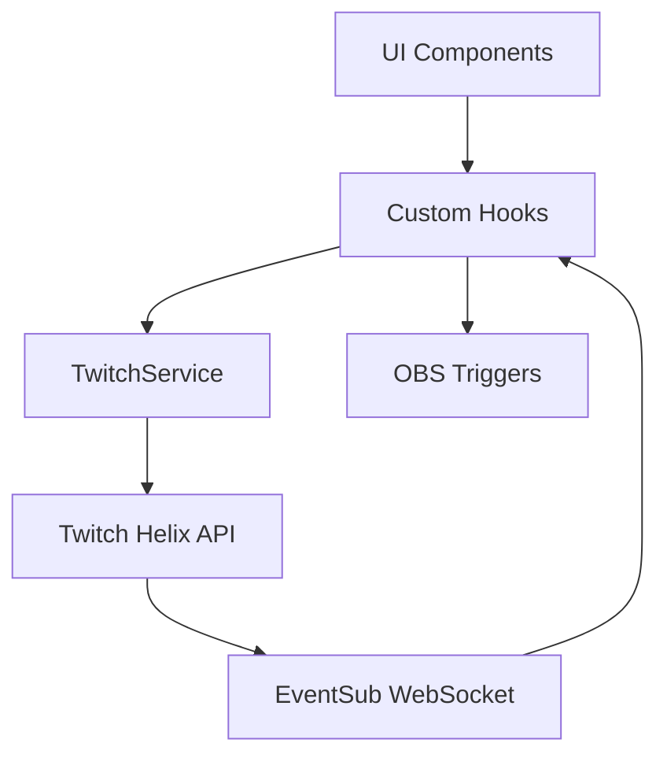

# Design Document: Twitch Tools Implementation

## Overview

Esta feature implementa tres herramientas de Twitch: Predicciones, Channel Points (Recompensas), y mejoras a Comandos. Utiliza la Twitch Helix API para predicciones y recompensas, y añade funcionalidad de import/export al sistema de comandos existente.

## Architecture

### Estructura de Componentes

```
Plataformas > Twitch > Herramientas
├── Comandos (existente + import/export)
├── Predicciones (nuevo)
│   ├── Crear Predicción
│   ├── Predicción Activa
│   └── Historial
└── Channel Points (nuevo)
    ├── Recompensas
    └── Redenciones
```

### Flujo de Datos



### Scopes OAuth Requeridos

```typescript
const REQUIRED_SCOPES = {
  predictions: 'channel:manage:predictions',
  rewards: 'channel:manage:redemptions',
  readRewards: 'channel:read:redemptions',
};
```

## Components and Interfaces

### Nuevos Componentes

#### 1. PredictionPanel

```typescript
// components/PredictionPanel.tsx

interface PredictionPanelProps {
  channelId: string;
  authToken: string;
  isPartnerOrAffiliate: boolean;
  onNotification: (type: string, message: string) => void;
}

const PredictionPanel: React.FC<PredictionPanelProps>
```

#### 2. PredictionForm

```typescript
// components/PredictionForm.tsx

interface PredictionFormData {
  title: string;
  outcomes: string[]; // 2-10 outcomes
  duration: number; // seconds (30-1800)
}

interface PredictionFormProps {
  onSubmit: (data: PredictionFormData) => Promise<void>;
  isLoading: boolean;
  disabled?: boolean;
}

const PredictionForm: React.FC<PredictionFormProps>
```

#### 3. ActivePrediction

```typescript
// components/ActivePrediction.tsx

interface ActivePredictionProps {
  prediction: TwitchPrediction;
  onLock: () => Promise<void>;
  onResolve: (outcomeId: string) => Promise<void>;
  onCancel: () => Promise<void>;
  isLoading: boolean;
}

const ActivePrediction: React.FC<ActivePredictionProps>
```

#### 4. RewardsPanel

```typescript
// components/RewardsPanel.tsx

interface RewardsPanelProps {
  channelId: string;
  authToken: string;
  onNotification: (type: string, message: string) => void;
}

const RewardsPanel: React.FC<RewardsPanelProps>
```

#### 5. RedemptionsList

```typescript
// components/RedemptionsList.tsx

interface RedemptionsListProps {
  redemptions: TwitchRedemption[];
  onFulfill: (redemptionId: string) => Promise<void>;
  onReject: (redemptionId: string) => Promise<void>;
  filterRewardId?: string;
}

const RedemptionsList: React.FC<RedemptionsListProps>
```

### Hooks

#### usePredictions

```typescript
// src/application/hooks/usePredictions.ts

interface UsePredictionsReturn {
  currentPrediction: TwitchPrediction | null;
  history: TwitchPrediction[];
  isLoading: boolean;
  error: string | null;
  
  createPrediction: (data: PredictionFormData) => Promise<void>;
  lockPrediction: () => Promise<void>;
  resolvePrediction: (outcomeId: string) => Promise<void>;
  cancelPrediction: () => Promise<void>;
  refreshPrediction: () => Promise<void>;
}

const usePredictions = (channelId: string, authToken: string): UsePredictionsReturn
```

#### useRewards

```typescript
// src/application/hooks/useRewards.ts

interface UseRewardsReturn {
  rewards: TwitchReward[];
  redemptions: TwitchRedemption[];
  isLoading: boolean;
  error: string | null;
  
  createReward: (data: RewardFormData) => Promise<void>;
  updateReward: (id: string, data: Partial<RewardFormData>) => Promise<void>;
  deleteReward: (id: string) => Promise<void>;
  toggleReward: (id: string, enabled: boolean) => Promise<void>;
  fulfillRedemption: (id: string) => Promise<void>;
  rejectRedemption: (id: string) => Promise<void>;
  refreshRedemptions: () => Promise<void>;
}

const useRewards = (channelId: string, authToken: string): UseRewardsReturn
```

#### useCommandsExport

```typescript
// src/application/hooks/useCommandsExport.ts

interface CommandExportFormat {
  version: string;
  exportedAt: string;
  commands: ExportedCommand[];
}

interface UseCommandsExportReturn {
  exportCommands: () => void; // Downloads JSON file
  importCommands: (file: File, mode: 'merge' | 'replace') => Promise<ImportResult>;
  validateImport: (data: unknown) => ValidationResult;
}

const useCommandsExport = (commands: CustomCommand[], onImport: (commands: CustomCommand[]) => void): UseCommandsExportReturn
```

### Services

#### TwitchPredictionService

```typescript
// src/application/services/TwitchPredictionService.ts

interface TwitchPredictionService {
  getPredictions(channelId: string): Promise<TwitchPrediction[]>;
  createPrediction(channelId: string, data: CreatePredictionData): Promise<TwitchPrediction>;
  endPrediction(channelId: string, predictionId: string, status: 'RESOLVED' | 'CANCELED' | 'LOCKED', winningOutcomeId?: string): Promise<TwitchPrediction>;
}
```

#### TwitchRewardsService

```typescript
// src/application/services/TwitchRewardsService.ts

interface TwitchRewardsService {
  getCustomRewards(channelId: string): Promise<TwitchReward[]>;
  createCustomReward(channelId: string, data: CreateRewardData): Promise<TwitchReward>;
  updateCustomReward(channelId: string, rewardId: string, data: UpdateRewardData): Promise<TwitchReward>;
  deleteCustomReward(channelId: string, rewardId: string): Promise<void>;
  getRedemptions(channelId: string, rewardId?: string, status?: string): Promise<TwitchRedemption[]>;
  updateRedemptionStatus(channelId: string, rewardId: string, redemptionId: string, status: 'FULFILLED' | 'CANCELED'): Promise<void>;
}
```

### Estructura de Archivos

```
components/
├── PredictionPanel.tsx       # Panel principal de predicciones
├── PredictionForm.tsx        # Formulario crear predicción
├── ActivePrediction.tsx      # Vista predicción activa
├── PredictionHistory.tsx     # Historial de predicciones
├── RewardsPanel.tsx          # Panel principal de recompensas
├── RewardForm.tsx            # Formulario crear/editar recompensa
├── RedemptionsList.tsx       # Lista de redenciones
├── CommandPanel.tsx          # Existente + import/export
└── ...

src/application/
├── hooks/
│   ├── usePredictions.ts     # Hook para predicciones
│   ├── useRewards.ts         # Hook para recompensas
│   └── useCommandsExport.ts  # Hook para import/export
├── services/
│   ├── TwitchPredictionService.ts
│   └── TwitchRewardsService.ts
└── ...
```

## Data Models

### Tipos de Twitch API

```typescript
// types/twitch.ts

interface TwitchPrediction {
  id: string;
  broadcaster_id: string;
  broadcaster_name: string;
  title: string;
  winning_outcome_id: string | null;
  outcomes: TwitchOutcome[];
  prediction_window: number;
  status: 'ACTIVE' | 'LOCKED' | 'RESOLVED' | 'CANCELED';
  created_at: string;
  ended_at: string | null;
  locked_at: string | null;
}

interface TwitchOutcome {
  id: string;
  title: string;
  users: number;
  channel_points: number;
  top_predictors: TwitchPredictor[] | null;
  color: 'BLUE' | 'PINK';
}

interface TwitchPredictor {
  user_id: string;
  user_name: string;
  channel_points_used: number;
  channel_points_won: number;
}

interface TwitchReward {
  id: string;
  broadcaster_id: string;
  title: string;
  prompt: string;
  cost: number;
  is_enabled: boolean;
  is_paused: boolean;
  is_in_stock: boolean;
  max_per_stream: { is_enabled: boolean; max_per_stream: number };
  max_per_user_per_stream: { is_enabled: boolean; max_per_user_per_stream: number };
  global_cooldown: { is_enabled: boolean; global_cooldown_seconds: number };
  background_color: string;
  image: { url_1x: string; url_2x: string; url_4x: string } | null;
  default_image: { url_1x: string; url_2x: string; url_4x: string };
  should_redemptions_skip_request_queue: boolean;
  redemptions_redeemed_current_stream: number | null;
}

interface TwitchRedemption {
  id: string;
  user_id: string;
  user_name: string;
  user_input: string;
  status: 'UNFULFILLED' | 'FULFILLED' | 'CANCELED';
  redeemed_at: string;
  reward: {
    id: string;
    title: string;
    prompt: string;
    cost: number;
  };
}
```

### Formato de Export de Comandos

```typescript
// types/commandExport.ts

interface CommandExportFormat {
  version: '1.0';
  exportedAt: string; // ISO date
  source: 'twitch-vote';
  commands: ExportedCommand[];
}

interface ExportedCommand {
  name: string;
  response: string;
  cooldown: number;
  userLevel: 'everyone' | 'subscriber' | 'vip' | 'moderator' | 'broadcaster';
  enabled: boolean;
  // Metadata for compatibility
  aliases?: string[];
  description?: string;
}
```

## Correctness Properties

*A property is a characteristic or behavior that should hold true across all valid executions of a system—essentially, a formal statement about what the system should do. Properties serve as the bridge between human-readable specifications and machine-verifiable correctness guarantees.*

### Property 1: Prediction Form Validation

*For any* prediction form submission, the system SHALL validate that: title is non-empty, outcomes count is between 2 and 10, duration is between 30 and 1800 seconds, and all outcome titles are non-empty and unique.

**Validates: Requirements 1.1**

### Property 2: Prediction State Machine

*For any* prediction, the status transitions SHALL follow: ACTIVE → LOCKED → RESOLVED|CANCELED, or ACTIVE → RESOLVED|CANCELED. No other transitions are valid.

**Validates: Requirements 1.4, 2.3, 2.4, 2.5**

### Property 3: Prediction API Integration

*For any* prediction action (create, lock, resolve, cancel), the system SHALL call the correct Twitch API endpoint with valid parameters and handle the response appropriately.

**Validates: Requirements 1.2, 2.3, 2.4, 2.5**

### Property 4: Reward CRUD Operations

*For any* reward operation (create, update, delete, toggle), the system SHALL call the correct Twitch API endpoint and update the local state to reflect the change.

**Validates: Requirements 4.3, 4.4, 4.5**

### Property 5: Redemption Management

*For any* redemption action (fulfill, reject), the system SHALL update the redemption status via API and remove it from the pending list.

**Validates: Requirements 5.3**

### Property 6: Command Export Round-Trip

*For any* set of commands, exporting and then importing SHALL produce an equivalent set of commands (round-trip property).

**Validates: Requirements 6.1, 6.2, 6.5**

### Property 7: Command Import Validation

*For any* JSON input, the import validation SHALL correctly identify valid command export formats and reject invalid ones with specific error messages.

**Validates: Requirements 6.3, 6.6**

### Property 8: Permission Validation

*For any* API operation requiring specific scopes, the system SHALL check for the required scope before making the request and prompt for re-authentication if missing.

**Validates: Requirements 1.5, 4.2, 8.1**

### Property 9: Error Handling

*For any* API error response, the system SHALL display a user-friendly error message and not leave the UI in an inconsistent state.

**Validates: Requirements 8.2, 8.3, 8.4, 8.5**

### Property 10: OBS Event Emission

*For any* prediction state change or reward redemption, the system SHALL emit the corresponding OBS trigger event.

**Validates: Requirements 7.1, 7.2**

## Error Handling

### API Errors

```typescript
const handleApiError = (error: TwitchApiError): string => {
  switch (error.status) {
    case 401:
      return 'Token expirado o sin permisos. Por favor, reconecta tu cuenta.';
    case 403:
      return 'No tienes permisos para esta acción. ¿Eres Partner o Affiliate?';
    case 404:
      return 'Recurso no encontrado.';
    case 429:
      return 'Demasiadas solicitudes. Espera un momento.';
    default:
      return `Error: ${error.message}`;
  }
};
```

### Rate Limiting

```typescript
const withRateLimit = async <T>(fn: () => Promise<T>, retries = 3): Promise<T> => {
  try {
    return await fn();
  } catch (error) {
    if (error.status === 429 && retries > 0) {
      await delay(1000 * (4 - retries)); // Exponential backoff
      return withRateLimit(fn, retries - 1);
    }
    throw error;
  }
};
```

### Validation Errors

```typescript
const validatePredictionForm = (data: PredictionFormData): ValidationResult => {
  const errors: string[] = [];
  
  if (!data.title.trim()) {
    errors.push('El título es requerido');
  }
  if (data.outcomes.length < 2) {
    errors.push('Se requieren al menos 2 opciones');
  }
  if (data.outcomes.length > 10) {
    errors.push('Máximo 10 opciones permitidas');
  }
  if (data.duration < 30 || data.duration > 1800) {
    errors.push('La duración debe ser entre 30 segundos y 30 minutos');
  }
  
  const uniqueOutcomes = new Set(data.outcomes.map(o => o.toLowerCase().trim()));
  if (uniqueOutcomes.size !== data.outcomes.length) {
    errors.push('Las opciones deben ser únicas');
  }
  
  return { valid: errors.length === 0, errors };
};
```

## Testing Strategy

### Unit Tests

1. **PredictionForm Component**
   - Valida límites de outcomes (2-10)
   - Valida duración (30-1800s)
   - Muestra errores de validación

2. **ActivePrediction Component**
   - Muestra datos de cada outcome
   - Botones correctos según estado
   - Maneja loading states

3. **RewardsPanel Component**
   - Lista recompensas correctamente
   - Formulario de creación funciona
   - Toggle enable/disable funciona

4. **Command Import/Export**
   - Export genera JSON válido
   - Import valida estructura
   - Round-trip preserva datos

### Property-Based Tests

Se utilizará **fast-check** para los tests de propiedades.

1. **Property 1**: Generar forms aleatorios y verificar validación
2. **Property 2**: Generar secuencias de estados y verificar transiciones válidas
3. **Property 6**: Generar comandos aleatorios y verificar round-trip
4. **Property 7**: Generar JSON aleatorio y verificar validación
5. **Property 9**: Generar errores API y verificar mensajes

### Integration Tests

1. Flujo completo de predicción: crear → lock → resolve
2. Flujo de recompensa: crear → redención → fulfill
3. Import/export de comandos con diferentes configuraciones
