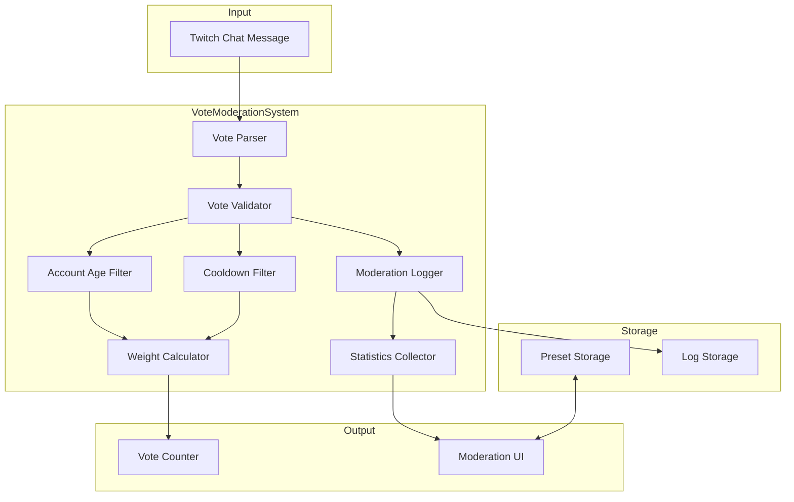

# Design Document: Vote Moderation System

## Overview

The Vote Moderation System extends TwitchVote Live with tools to ensure fair and trustworthy voting. It provides streamers with configurable filters, weighted voting, and real-time moderation statistics. The system integrates with the existing Twitch chat voting mechanism while adding a validation layer that processes votes before they are counted.

## Architecture



## Components and Interfaces

### ModerationConfig Interface

```typescript
interface ModerationConfig {
  minAccountAgeDays: number;           // 0 = no filter
  voteChangeEnabled: boolean;
  voteChangeCooldownSeconds: number;
  weights: {
    subscriber: number;                 // 1-5
    follower: number;                   // 1-5
    regular: number;                    // always 1
  };
}
```

### VoteValidator Component

Responsible for validating incoming votes against moderation rules.

```typescript
interface VoteValidationResult {
  isValid: boolean;
  rejectionReason?: RejectionReason;
  weight: number;
}

type RejectionReason = 
  | 'ACCOUNT_TOO_YOUNG'
  | 'COOLDOWN_ACTIVE'
  | 'VOTE_CHANGE_DISABLED'
  | 'INVALID_OPTION';
```

### ModerationLogger Component

Records all moderation actions for review.

```typescript
interface ModerationLogEntry {
  timestamp: number;
  username: string;
  userId: string;
  action: 'REJECTED' | 'ACCEPTED' | 'VOTE_CHANGED';
  reason?: RejectionReason;
  optionId: number;
  weight: number;
}
```

### StatisticsCollector Component

Aggregates real-time moderation statistics.

```typescript
interface ModerationStats {
  totalAttempts: number;
  acceptedVotes: number;
  rejectedByReason: Record<RejectionReason, number>;
  acceptanceRate: number;              // percentage 0-100
}
```

### PresetManager Component

Handles saving and loading moderation presets.

```typescript
interface ModerationPreset {
  id: string;
  name: string;
  config: ModerationConfig;
  createdAt: number;
}
```

## Data Models

### Extended Poll Type

```typescript
interface ModeratedPoll extends Poll {
  moderationConfig: ModerationConfig;
  moderationStats: ModerationStats;
  moderationLog: ModerationLogEntry[];
}
```

### User Vote State

```typescript
interface UserVoteState {
  optionId: number;
  timestamp: number;
  weight: number;
  canChangeAt?: number;                // timestamp when change is allowed
}
```

### Storage Keys

- `twitch_vote_mod_presets`: Array of ModerationPreset
- `twitch_vote_mod_log_{pollId}`: Array of ModerationLogEntry (per poll)

## Correctness Properties

*A property is a characteristic or behavior that should hold true across all valid executions of a system-essentially, a formal statement about what the system should do. Properties serve as the bridge between human-readable specifications and machine-verifiable correctness guarantees.*

### Property 1: Account age filtering correctness
*For any* user account age and *any* configured minimum age threshold, a vote is accepted if and only if the account age is greater than or equal to the threshold, with the special case that threshold 0 accepts all accounts.
**Validates: Requirements 1.2, 1.3**

### Property 2: Rejection counter invariant
*For any* sequence of vote attempts, the rejection counter equals the count of votes where isValid is false.
**Validates: Requirements 1.4**

### Property 3: Vote weight bounds validation
*For any* weight configuration input, the system accepts the value if and only if it is an integer between 1 and 5 inclusive.
**Validates: Requirements 2.1**

### Property 4: Vote weight calculation correctness
*For any* user with a known trust level (subscriber, follower, or regular) and *any* valid weight configuration, the calculated vote weight equals the configured weight for that trust level, with regular users always receiving weight 1.
**Validates: Requirements 2.2, 2.3, 2.4**

### Property 5: Weighted totals display accuracy
*For any* poll with weighted votes, the displayed weighted total equals the sum of (vote count × weight) for each vote.
**Validates: Requirements 2.5**

### Property 6: Log entry completeness
*For any* rejected vote, the corresponding log entry contains a non-empty username, a valid timestamp, and a rejection reason from the defined set.
**Validates: Requirements 3.1**

### Property 7: Log display limit
*For any* moderation log with N entries, the displayed entries count is min(N, 100).
**Validates: Requirements 3.2**

### Property 8: Log grouping correctness
*For any* set of log entries, the sum of counts across all rejection reason groups equals the total number of rejected entries.
**Validates: Requirements 3.4**

### Property 9: Cooldown enforcement
*For any* vote change attempt where (current time - last vote time) < cooldown period, the change is rejected and the original vote is preserved.
**Validates: Requirements 4.2**

### Property 10: Vote change prevention when disabled
*For any* user who has already voted, when vote changing is disabled, all subsequent vote attempts from that user are rejected.
**Validates: Requirements 4.3**

### Property 11: Vote change count invariant
*For any* successful vote change from option A to option B, the total vote count remains unchanged, option A's count decreases by the user's weight, and option B's count increases by the user's weight.
**Validates: Requirements 4.4**

### Property 12: Statistics accuracy
*For any* poll state, the acceptance rate equals (acceptedVotes / totalAttempts) × 100, and the sum of rejectedByReason values plus acceptedVotes equals totalAttempts.
**Validates: Requirements 5.1, 5.2, 5.3**

### Property 13: Warning threshold trigger
*For any* poll where acceptance rate < 50%, the warning indicator is displayed; for acceptance rate >= 50%, the warning is not displayed.
**Validates: Requirements 5.4**

### Property 14: Preset round-trip consistency
*For any* valid ModerationConfig, saving it as a preset and then loading that preset produces an equivalent configuration.
**Validates: Requirements 6.1, 6.2**

### Property 15: Preset deletion completeness
*For any* preset that is deleted, subsequent attempts to load that preset return null or throw a not-found error.
**Validates: Requirements 6.3**

### Property 16: Preset display completeness
*For any* saved preset, the display output contains the preset name and includes values for minAccountAgeDays, voteChangeEnabled, and weight configuration.
**Validates: Requirements 6.4**

## Error Handling

| Error Scenario | Handling Strategy |
|----------------|-------------------|
| Invalid weight value (outside 1-5) | Clamp to nearest valid value, show warning |
| Storage quota exceeded for logs | Truncate oldest entries, notify streamer |
| Twitch API unavailable for account age | Fall back to allowing vote, log warning |
| Preset name already exists | Prompt for overwrite confirmation |
| Corrupted preset data | Skip invalid preset, log error |

## Testing Strategy

### Property-Based Testing

The system will use **fast-check** as the property-based testing library for TypeScript/JavaScript.

Each property-based test will:
- Run a minimum of 100 iterations
- Be tagged with a comment referencing the correctness property: `**Feature: vote-moderation, Property {number}: {property_text}**`
- Use smart generators that constrain inputs to valid ranges

### Unit Testing

Unit tests will cover:
- Edge cases for account age = 0 (no filter)
- Boundary conditions for weight values (1 and 5)
- Cooldown timing edge cases (exactly at boundary)
- Empty log handling
- Preset CRUD operations

### Test File Organization

```
tests/
  vote-moderation/
    voteValidator.test.ts        # Unit tests for validation logic
    voteValidator.property.ts    # Property tests for validation
    weightCalculator.test.ts     # Unit tests for weight calculation
    weightCalculator.property.ts # Property tests for weights
    moderationLogger.test.ts     # Unit tests for logging
    moderationLogger.property.ts # Property tests for logging
    statisticsCollector.test.ts  # Unit tests for statistics
    statisticsCollector.property.ts # Property tests for statistics
    presetManager.test.ts        # Unit tests for presets
    presetManager.property.ts    # Property tests for presets
```
