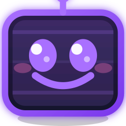

<div align="center">
  
  
  # TwitchVote Live
  
  **Suite completa de herramientas interactivas para streamers de Twitch**
  
  [](https://react.dev/)
  [](https://www.typescriptlang.org/)
  [](https://vitejs.dev/)
  [](https://tailwindcss.com/)
  [](https://www.electronjs.org/)
  
  [Demo](#demo) • [Características](#-características) • [Instalación](#-instalación) • [Juegos](#-juegos-interactivos) • [Documentación](#-documentación)
</div>

---

## 🎯 ¿Qué es TwitchVote?

TwitchVote es una aplicación todo-en-uno para streamers que quieren aumentar la interacción con su audiencia. Incluye encuestas en tiempo real, +15 juegos interactivos controlados por chat, sorteos, panel de jueces, y herramientas de moderación avanzadas.

Disponible como **aplicación web** y **aplicación de escritorio** (Electron).

---

## ✨ Características

### 📊 Encuestas en Vivo
- Creación de encuestas con opciones personalizables
- Votación por chat con prefijos configurables (`+1`, `#opcion`, etc.)
- Límite de votos y duración opcional
- Historial de encuestas con exportación
- Modo overlay para OBS/Streamlabs

### 🎮 Juegos Interactivos
+15 minijuegos controlados por el chat de Twitch:

| Juego | Descripción |
|-------|-------------|
| 🎰 **Casino Roulette** | Ruleta de casino con apuestas del chat |
| 🎣 **Chat Fishing** | Pesca competitiva entre viewers |
| 🔫 **Pium Game** | Duelos rápidos estilo western |
| 🦆 **Duck Hunt** | Caza de patos clásica |
| 🚢 **Battleship** | Hundir la flota colaborativo |
| 🥔 **Hot Potato** | Patata caliente entre usuarios |
| ❓ **Trivia Battle** | Preguntas y respuestas |
| 👁️ **Veo Veo** | Adivina el objeto |
| ✂️ **Piedra Papel Tijera** | Torneos de PPT |
| 📝 **Ahorcado** | El clásico juego de palabras |
| 🏎️ **Carrera de Emotes** | Carreras con emotes del canal |
| 🧠 **Memoria IRL** | Memory con imágenes personalizadas |
| 🎉 **Party & Co** | Minijuegos variados estilo party |

### 🎁 Sorteos y Giveaways
- Sorteos por palabra clave
- Filtros: solo subs, followers, etc.
- Ruleta visual con animación
- Historial de ganadores

### ⚖️ Panel de Jueces
- Sistema de puntuación multi-criterio
- Múltiples jueces (streamers colaboradores)
- Votación pública combinada
- Revelación dramática de resultados

### 🛡️ Moderación Avanzada
- Filtros de antigüedad de cuenta
- Cooldown entre votos
- Peso de votos (subs valen más)
- Logs exportables
- Presets de configuración

### 🎨 Personalización
- Temas claro/oscuro
- Colores personalizables
- Overlays transparentes para OBS
- Mascota AI interactiva
- Soporte multi-idioma (ES/EN)

### 📈 Analytics
- Estadísticas de stream en tiempo real
- Historial de sesiones
- Análisis de participación
- Exportación de datos

---

## 🚀 Instalación

### Requisitos
- Node.js 18+
- npm o yarn

### Desarrollo Local

```bash
# Clonar el repositorio
git clone https://github.com/tu-usuario/twitchvote-live.git
cd twitchvote-live

# Instalar dependencias
npm install

# Configurar variables de entorno
cp .env.local.example .env.local
# Editar .env.local con tus credenciales

# Iniciar en modo desarrollo
npm run dev
```

La aplicación estará disponible en `http://localhost:5173`

### Aplicación de Escritorio (Electron)

```bash
# Desarrollo con Electron
npm run electron:dev

# Compilar ejecutable
npm run electron:build
```

### Despliegue Web

```bash
# Compilar para producción
npm run build

# Preview local
npm run preview
```

Compatible con Vercel, Netlify, o cualquier hosting estático.

---

## ⚙️ Configuración

### Variables de Entorno

Crea un archivo `.env.local` en la raíz:

```env
# Twitch OAuth (opcional - para funciones avanzadas)
VITE_TWITCH_CLIENT_ID=tu_client_id
VITE_TWITCH_REDIRECT_URI=http://localhost:5173/auth/callback

# Gemini API (opcional - para mascota AI)
GEMINI_API_KEY=tu_api_key
```

### Conexión a Twitch

1. Abre la aplicación
2. Ingresa el nombre de tu canal
3. (Opcional) Conecta con OAuth para funciones avanzadas:
   - Enviar mensajes al chat
   - Acceder a lista de subs
   - Emotes personalizados

---

## 🎬 Uso con OBS

### Overlay de Encuestas

1. En TwitchVote, crea una encuesta
2. Click en "Abrir Overlay"
3. En OBS: Agregar → Fuente de navegador
4. URL: `http://localhost:5173/?overlay=true&channel=TU_CANAL`
5. Ancho: 400px, Alto: 600px
6. Marcar "Fondo transparente"

### Overlays de Juegos

Cada juego tiene su propio overlay:

```
# Ejemplos de URLs de overlay
?overlayPium=true        # Pium Game
?overlayRoulette=true    # Casino Roulette
?overlayFishing=true     # Chat Fishing
?overlayTrivia=true      # Trivia Battle
?overlayDuckHunt=true    # Duck Hunt
?overlayAhorcado=true    # Ahorcado
?overlayCarrera=true     # Carrera de Emotes
```

---

## 🧪 Testing

```bash
# Tests unitarios
npm run test

# Tests E2E con Playwright
npm run test:e2e

# Tests E2E con UI
npm run test:e2e:ui

# Todos los tests
npm run test:all
```

---

## 📁 Estructura del Proyecto

```
├── components/          # Componentes React
│   ├── games/          # Juegos interactivos
│   └── mascot/         # Mascota AI
├── hooks/              # Custom hooks
├── services/           # Servicios (Twitch, AI, etc.)
├── context/            # React Context providers
├── i18n/               # Traducciones
├── constants/          # Constantes
├── electron/           # Código Electron
├── tests/              # Tests
└── public/             # Assets estáticos
```

---

## 🤝 Contribuir

¡Las contribuciones son bienvenidas! 

1. Fork el repositorio
2. Crea una rama (`git checkout -b feature/nueva-funcionalidad`)
3. Commit tus cambios (`git commit -m 'Añade nueva funcionalidad'`)
4. Push a la rama (`git push origin feature/nueva-funcionalidad`)
5. Abre un Pull Request

---

## 📄 Licencia

Este proyecto está bajo la licencia MIT. Ver [LICENSE](LICENSE) para más detalles.

---

<div align="center">
  <p>Hecho con 💜 para la comunidad de Twitch</p>
</div>
