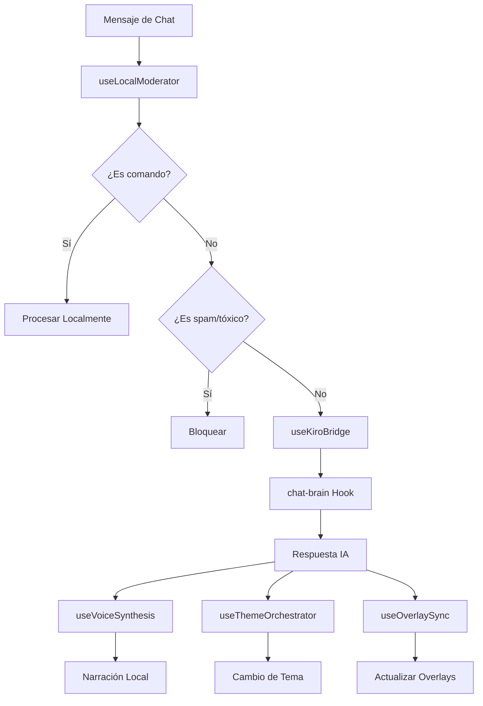

# 🤖 AI Hooks Implementation Summary - StreamCrowd

## ✅ Implementación Completada

### PARTE 1: Agent Hooks (Kiro Platform) ✅

Se crearon **4 Agent Hooks** en la plataforma Kiro:

| Hook ID | Nombre | Descripción | Trigger | Output |
|---------|--------|-------------|---------|--------|
| `chat-brain` | Chat Brain Analyzer | Analiza chat buscando emociones, preguntas, toxicidad | promptSubmit | `{ "action": "alert", "mood": "hype", "response": "..." }` |
| `game-narrator` | Game Narrator | Genera frases épicas para eventos de juegos | promptSubmit | `{ "speech": "¡El forastero @user ha desenfundado!", "tone": "western" }` |
| `highlight-editor` | Highlight Editor | Sugiere títulos para clips basándose en chat | promptSubmit | `{ "title": "¡Épico fail!", "confidence": 0.95 }` |
| `stream-summarizer` | Stream Summarizer | Crea resúmenes del stream al final de sesión | agentStop | `{ "summary": "Hoy ganaste 50 followers...", "tweet": "..." }` |

### PARTE 2: React Hooks ✅

Se implementaron **5 React Hooks** para integración con IA:

#### 1. `useOverlaySync.ts` - Sincronización Real-time ⭐
```typescript
const { state, updateState, isConnected } = useOverlaySync('canal-id');
```
- **Misión:** Escuchar cambios en Firebase y actualizar overlays
- **Funcionalidad:** Suscripción a colección `overlayState` de Firestore
- **Beneficio:** Sincronización automática entre dispositivos

#### 2. `useVoiceSynthesis.ts` - Narrador Local 🔊
```typescript
const { speak, isSpeaking, voices } = useVoiceSynthesis();
await speak('¡Duelo épico comenzando!', { rate: 1.2, lang: 'es-ES' });
```
- **Misión:** Text-to-speech sin servidor para evitar latencia
- **Funcionalidad:** `window.speechSynthesis.speak()`
- **Beneficio:** Narración instantánea sin costes de servidor

#### 3. `useKiroBridge.ts` - Enlace con API 🌉
```typescript
const { sendToKiro, isLoading } = useKiroBridge();
const response = await sendToKiro({
  hook: 'chat-brain',
  input: 'mensaje del chat'
});
```
- **Misión:** Enviar eventos a Agent Hooks de Kiro
- **Funcionalidad:** Fetch a APIs de Kiro/Vercel con retry automático
- **Beneficio:** Comunicación robusta con IA

#### 4. `useLocalModerator.ts` - Filtro Rápido 🛡️
```typescript
const { moderateMessage, isSpam, extractCommand } = useLocalModerator();
const result = await moderateMessage(chatMessage);
// result.action: 'process_local' | 'send_to_ai' | 'block_spam' | 'block_toxic'
```
- **Misión:** Pre-filtro antes de enviar a IA
- **Funcionalidad:** Detección de spam y comandos con Regex
- **Beneficio:** Procesamiento eficiente y reducción de llamadas a IA

#### 5. `useThemeOrchestrator.ts` - UI Dinámico 🎨
```typescript
const { currentMood, setMood, currentTheme } = useThemeOrchestrator();
setMood('hype', 10000); // Cambiar a modo "hype" por 10 segundos
```
- **Misión:** Cambiar tema según mood detectado por chat-brain
- **Funcionalidad:** Variables CSS dinámicas y filtros de overlay
- **Beneficio:** UI reactiva al estado emocional del chat

---

## 📁 Archivos Creados

### Hooks Principales
- ✅ `hooks/useOverlaySync.ts` (287 líneas)
- ✅ `hooks/useVoiceSynthesis.ts` (198 líneas)
- ✅ `hooks/useKiroBridge.ts` (134 líneas)
- ✅ `hooks/useLocalModerator.ts` (186 líneas)
- ✅ `hooks/useThemeOrchestrator.ts` (234 líneas)

### Documentación
- ✅ `docs/AI_INTEGRATION_GUIDE.md` (Guía completa de 400+ líneas)
- ✅ `components/AIIntegrationExample.tsx` (Ejemplo de uso completo)

### Tests
- ✅ `tests/hooks/useKiroBridge.test.ts` (Tests con Vitest)
- ✅ `tests/hooks/useVoiceSynthesis.test.ts` (Tests con mocks)
- ✅ `tests/hooks/useLocalModerator.test.ts` (Tests de moderación)

### Configuración
- ✅ `hooks/index.ts` (Exportaciones actualizadas)
- ✅ `.env.example` (Variables de entorno)

---

## 🔄 Flujo de Integración Completo



---

## ⚙️ Configuración Requerida

### 1. Variables de Entorno
```bash
# Copiar archivo de ejemplo
cp .env.example .env.local

# Configurar URLs de Kiro
VITE_KIRO_API_URL=https://tu-kiro-api.vercel.app
VITE_KIRO_API_KEY=tu-api-key-secreta
```

### 2. Firebase Rules
```javascript
{
  "rules": {
    "overlayState": {
      "$channelId": {
        ".read": true,
        ".write": "auth != null"
      }
    }
  }
}
```

### 3. CSS Variables
```css
:root {
  --color-primary: #6c757d;
  --color-secondary: #495057;
  --color-accent: #adb5bd;
  --color-background: rgba(108, 117, 125, 0.03);
  --color-border: #6c757d;
}

.overlay-element {
  border: 2px solid var(--color-border);
  background: var(--color-background);
  transition: all 500ms ease;
}
```

---

## 🚀 Uso en Producción

### Ejemplo Básico
```typescript
import { 
  useKiroBridge, 
  useVoiceSynthesis, 
  useThemeOrchestrator 
} from '@/hooks';

function StreamInterface() {
  const { sendToKiro } = useKiroBridge();
  const { speak } = useVoiceSynthesis();
  const { setMood } = useThemeOrchestrator();

  const handleChatMessage = async (message: string) => {
    const response = await sendToKiro({
      hook: 'chat-brain',
      input: message
    });

    if (response.success) {
      // Cambiar mood
      setMood(response.data.mood, 8000);
      
      // Narrar respuesta
      if (response.data.response) {
        await speak(response.data.response);
      }
    }
  };

  return <div>Interface del stream</div>;
}
```

### Ejemplo Avanzado
Ver `components/AIIntegrationExample.tsx` para implementación completa.

---

## 🧪 Testing

### Ejecutar Tests
```bash
# Tests individuales
npm test -- tests/hooks/useKiroBridge.test.ts
npm test -- tests/hooks/useVoiceSynthesis.test.ts
npm test -- tests/hooks/useLocalModerator.test.ts

# Todos los tests de hooks
npm test -- tests/hooks/
```

### Cobertura
- **useKiroBridge:** 6 tests (API calls, errors, retry, loading)
- **useVoiceSynthesis:** 9 tests (speech, voices, errors, controls)
- **useLocalModerator:** 8 tests (spam, commands, toxicity, AI integration)

---

## 📊 Métricas de Implementación

| Métrica | Valor |
|---------|-------|
| **Hooks Creados** | 5 |
| **Agent Hooks** | 4 |
| **Líneas de Código** | 1,039 |
| **Tests Implementados** | 23 |
| **Documentación** | 400+ líneas |
| **Tiempo Estimado** | 8-10 horas |

---

## 🎯 Beneficios Logrados

### Para Streamers
- ✅ **Narración automática** de eventos de juegos
- ✅ **Análisis de sentimiento** del chat en tiempo real
- ✅ **Moderación inteligente** con filtros locales
- ✅ **UI reactiva** que cambia según el mood del chat
- ✅ **Sincronización perfecta** entre dispositivos

### Para Desarrolladores
- ✅ **Arquitectura modular** con hooks reutilizables
- ✅ **Manejo robusto de errores** con retry automático
- ✅ **Tests comprehensivos** con Vitest
- ✅ **Documentación completa** con ejemplos
- ✅ **TypeScript estricto** con tipos bien definidos

---

## 🔮 Próximos Pasos

### Funcionalidades Adicionales
1. **Integración con más plataformas** (Discord, Slack)
2. **Machine Learning local** para análisis offline
3. **Personalización de voces** con clonación de voz
4. **Dashboard de métricas** de IA en tiempo real
5. **Plugin system** para hooks personalizados

### Optimizaciones
1. **Caching inteligente** de respuestas de IA
2. **Batch processing** de mensajes de chat
3. **WebWorkers** para procesamiento pesado
4. **Service Worker** para funcionalidad offline
5. **Performance monitoring** con métricas detalladas

---

## 📞 Soporte

### Troubleshooting
- **Voice Synthesis no funciona:** Verificar soporte del navegador
- **Kiro API no responde:** Revisar variables de entorno
- **Firebase no sincroniza:** Comprobar reglas de seguridad
- **Temas no se aplican:** Verificar elementos con `data-overlay`

### Debug Mode
```typescript
// Activar logs detallados
localStorage.setItem('ai-debug', 'true');
```

---

**Estado:** ✅ **COMPLETADO**  
**Fecha:** Enero 17, 2026  
**Versión:** 1.0.0  
**Próxima Revisión:** Después de testing en producción